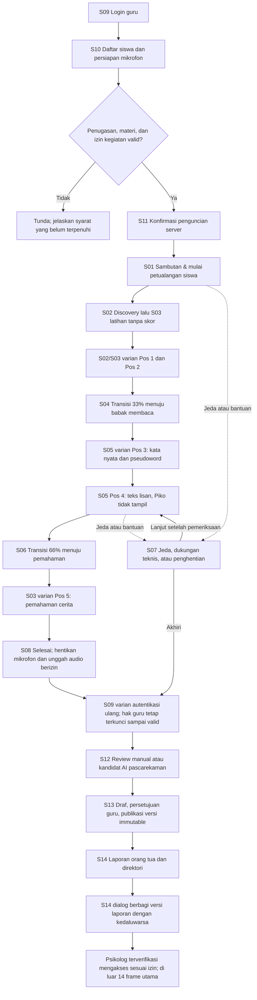

# Dyscovery Design System & Desktop Screen Specification

Versi: 1.4, konsolidasi brief desktop dan referensi flow sistem

Tanggal: 29 Oktober 2026

Tagline: Kenali risiko, temukan dukungan.

Status: spesifikasi desain untuk implementasi dan verifikasi, bukan bukti kesiapan produksi atau validasi klinis.

## 1. Tujuan, ruang lingkup, dan sumber acuan

Dyscovery membantu guru mendokumentasikan observasi membaca dan skrining awal risiko disleksia siswa kelas 2 SD berbahasa Indonesia. Sesi sekolah berjalan pada satu perangkat guru; siswa memakai Mode Siswa sementara tanpa akun. Orang tua membuka laporan dan memilih dukungan profesional melalui portalnya sendiri.

Deliverable desain terdiri dari 14 frame utama, semuanya berukuran **1440 × 900 px**, termasuk layar login, transisi, dan presentasi modal. Tidak ada mockup mobile dalam deliverable ini. Varian aktivitas, error, dan dialog tetap memakai canvas desktop yang sama, bukan layar utama tambahan.

Dokumen ini mengatur desain dan perilaku UI, bukan mengubah kontrak backend atau menyatakan semua fitur sudah tersedia.

| Referensi lokal | Digunakan untuk |
|---|---|
| [PRD](Dyscovery-PRD.md), §1–8 dan §11 | Tujuan, pengguna, lima pos, batas AI, integritas sesi, dan scope MVP |
| [Workflow](Dyscovery-Workflow.md), §1–6 | Urutan kegiatan, review, publikasi, berbagi, dan pencabutan |
| [Security Rules](Dyscovery-Security-Rules.md), §2–9 | Otorisasi, perpindahan mode, consent, audio, serta batas penilaian |
| [ERD](Dyscovery-ERD.md), §2–4 | Identitas, versi materi, sesi, review, laporan, dan izin berbagi |
| [Implementation Progress](Implementation-Progress.md), checkpoint 29 Oktober 2026 | Status implementasi, bukti yang tersedia, dan pekerjaan terbuka |
| Brief pemilik dalam percakapan | 14 frame desktop, warna inti, filename aset, dan Piko berbentuk buku saku |

### 1.1 Cara membaca aturan

- **Wajib:** requirement brief atau aturan sistem yang harus dipenuhi.
- **Rekomendasi:** ukuran/tata letak yang diusulkan dokumen ini; dapat disesuaikan setelah pengujian tanpa mengubah aturan sistem.
- **Perlu konfirmasi:** konflik sumber atau kebijakan yang belum boleh diperlakukan sebagai keputusan produksi.

Untuk keamanan dan persetujuan, gunakan batas yang lebih ketat dari Security Rules; jangan melonggarkannya berdasarkan gambar UI. Untuk identitas visual dan ukuran frame, gunakan brief terbaru. Konflik aturan produk dicatat di §13, bukan diselesaikan dengan mengubah database dari dokumen desain.

### 1.2 Batas produk dan bahasa hasil

- Hasil adalah **laporan observasi**, bukan diagnosis, terapi, atau pernyataan “bebas disleksia”.
- Tidak ada klasifikasi risiko, ambang, persentil, atau skor yang dikarang sebelum instrumen dan pedoman resmi tersedia.
- Kandidat AI selalu memerlukan verifikasi guru. Pseudoword ditinjau manual pada baseline.
- Latihan tidak dinilai dan tidak masuk hasil skrining. Koreksi benar/salah hanya boleh pada latihan.
- Kendala audio, bantuan guru, tugas dilewati, dan anak tidak bersedia dicatat terpisah dari kesalahan membaca.
- Nama, foto, kredensial, dan hasil contoh memakai placeholder eksplisit, bukan identitas profesional rekaan.
- Angka penghematan kerja 80–90% dan latensi 2–15 detik di sumber adalah target yang belum dibuktikan menurut Implementation Progress; jangan dijadikan janji UI.

## 2. Prinsip pengalaman dan arah visual

| Konteks | Arah | Alasan |
|---|---|---|
| Petualangan | ENERGY 2 / RHYTHM 2 / MOTION 2 | Peta hutan dan Piko memberi konteks perjalanan; gerak hanya untuk transisi dan apresiasi |
| Membaca aktif | ENERGY 1 / RHYTHM 1 / MOTION 1 | Teks stabil menjadi satu-satunya fokus; tanpa gerak dekoratif |
| Guru dan orang tua | ENERGY 1 / RHYTHM 1 / MOTION 1 | Hierarki dan status yang dapat dipindai lebih penting daripada dekorasi |

Motif identitas: lipatan apricot dari buku saku Piko, dipakai terbatas pada checkpoint dan penghargaan. Jangan menambah motif ini pada stimulus membaca. Pixel-art hanya untuk lingkungan petualangan; teks UI memakai Nunito Sans, stimulus bacaan anak memakai Andika.

Satu layar memiliki satu fokus dan satu tindakan utama. Kartu digunakan untuk memisahkan objek kerja seperti bacaan, review, dan profil, bukan membungkus setiap paragraf. Bayangan hanya menandai elevasi dialog/kartu stimulus; panel administratif cukup memakai pemisah.

## 3. Design tokens

### 3.1 Warna inti

| Token | Nilai | Penggunaan |
|---|---|---|
| `color.primary` | `#24476A` | Navigasi, heading struktural, tombol primer, tautan |
| `color.accent` | `#F2B880` | Progres naratif, lipatan Piko, reward; bukan warna teks di permukaan putih |
| `color.background` | `#FAF8F4` | Canvas seluruh modul |
| `color.surface` | `#FFFFFF` | Kartu, tabel, form, stimulus, dialog |
| `color.text` | `#202C38` | Body, heading, stimulus |

Pasangan teks wajib: putih pada primary; text atau primary pada putih/warm white; text pada apricot. Jangan memakai putih pada apricot. Angka kontras tidak disalin dari dokumen lama; periksa kombinasi aktual, termasuk hover dan disabled, sebelum menyatakan lolos AA.

### 3.2 Token pendukung (rekomendasi)

| Token | Nilai | Penggunaan |
|---|---|---|
| `color.textMuted` | `#526171` | Metadata yang tetap terbaca |
| `color.border` | `#D8DEE4` | Pemisah panel non-interaktif |
| `color.controlBorder` | `#687787` | Batas input/kontrol ketika diperlukan untuk identifikasi |
| `color.successText` / `successSurface` | `#246335` / `#EAF4EC` | Persetujuan aktif, tindakan tersimpan |
| `color.warningText` / `warningSurface` | `#8A4B12` / `#FFF1E1` | Izin menunggu, perlu perhatian |
| `color.dangerText` / `dangerSurface` | `#A12A2A` / `#FCECEC` | Error teknis, tindakan destruktif |
| `color.overlay` | `#202C3899` | Dim layar di belakang dialog |

Warna status selalu disertai label. Hijau tidak berarti anak “normal”, dan merah tidak berarti diagnosis. Warna hutan dari versi sebelumnya tetap boleh untuk ilustrasi: canopy `#2D5A27`, tanah `#8D6E63`, kelapa/ubin `#E6A15C`; bukan aksen administratif tambahan.

### 3.3 Typography

Font UI: **Nunito Sans**, bobot 400, 600, 700; fallback sans-serif. Font stimulus bacaan anak: **Andika** (SIL OFL), bobot 400 dan 700, letter-spacing 0.08em, line-height 1.75, rata kiri, tanpa italic/kapital semua/garis bawah, 28px (24px di layar sempit), latar `#FAF8F4`. Keputusan pemilik 29 Okt 2026 sebagai pilihan awal, bukan klaim klinis; jangan menulis klaim "ramah disleksia" di UI. Font dikunci dan diversikan; ganti font hanya dengan versi materi baru, idealnya setelah dikonfirmasi ahli dan diuji pada anak. Ketersediaan font tidak boleh mengubah ukuran stimulus tanpa pemeriksaan ulang layout.

| Peran | Ukuran | Bobot | Line height |
|---|---|---|---|
| Page title | 32 px | 700 | 1.3 |
| Section title | 24 px | 600 | 1.4 |
| Subheading | 20 px | 600 | 1.4 |
| Body | 16 px | 400 | 1.5 |
| Button / label | 16 px | 600 | 1.5 |
| Caption / badge | 14 px | 600 | 1.4 |
| Instruksi petualangan | 24 px | 600 | 1.4 |
| Stimulus membaca aktif | **28 px** | **600** | **1.6** |

Stimulus rata kiri, letter-spacing normal, tanpa justified, hyphenation otomatis, pewarnaan kata live, atau font pixel. Ukuran 28px menetapkan satu pilihan dari rentang 26–28px di sumber lama. Pertahankan pemenggalan baris dan konfigurasi penyajian sesuai versi materi; jangan mengecilkan huruf untuk memuat teks panjang.

### 3.4 Spacing, radius, dan ukuran kontrol (rekomendasi)

- Skala spacing: 4, 8, 12, 16, 24, 32, 40, 48, 64 px.
- Radius: input/button 8px, panel 12px, stimulus/dialog 16px; badge 6px. Pill bukan bentuk default.
- Tinggi kontrol dewasa 48px; tombol primer siswa 56px. Semua hit area minimal 44 × 44px.
- Ubin huruf minimal 56 × 56px; rekomendasi 72 × 72px dengan jarak 12px.
- Padding panel 24px, dialog 32px, stimulus 48px. Ruang antarseksi 32px.
- Elevasi dialog: `0 16px 48px #202C3826`; stimulus: `0 4px 20px #202C380F`.

## 4. Layout desktop 1440 × 900

Semua frame memakai Auto Layout/flex/grid dengan ukuran frame tetap. Isi panel boleh fluid dalam frame; jangan membuat versi mobile atau mengecilkan seluruh UI dengan transform.

| Shell | Dimensi rekomendasi |
|---|---|
| Guru | Sidebar 224px; header area kerja 80px; padding main 32px; lebar main tersedia 1152px |
| Siswa | Header 80px; stage 740px; area kontrol bawah 80px, total 900px |
| Login | Canvas penuh, card lebar 480px, padding 40px, posisi tengah |
| Stimulus | Kartu max-width 840px, centered; area teks stabil di dalam padding 48px |
| Modal | Frame induk tetap 1440 × 900; dialog 560–640px, max-height 760px |
| Portal orang tua S14 | Header 80px, padding 32px; ringkasan 352px + gap 24px + direktori 1000px |

S14: area isi tersedia 1376px. Direktori tiga kolom memakai `(1000 - 2 × 16) / 3`, sekitar 322px per kartu. Gunakan dua baris awal bila data tersedia dan scroll vertikal halaman untuk sisanya. Nama, kredensial, serta CTA boleh membungkus; jangan dipotong tanpa akses ke teks lengkap.

Dashboard boleh scroll vertikal; heading dan tabel tidak boleh bertabrakan. Sidebar tetap, header tabel dapat sticky. Stimulus aktif tidak auto-scroll, bergeser karena status mikrofon, atau berubah lebar. Materi lebih panjang harus dipaginasi menurut protokol materi, bukan pemotongan otomatis oleh UI.

## 5. Logo dan aset Piko

### 5.1 Logo wajib

| Filename persis | Lokasi penggunaan | Path publik existing |
|---|---|---|
| `logo-horizontal.svg` | Navbar desktop | `/brand/logo-horizontal.svg` |
| `logo-symbol.svg` | Sidebar ringkas/collapsed | `/brand/logo-symbol.svg` |
| `logo-with-tagline.svg` | Login dan splash | `/brand/logo-with-tagline.svg` |
| `logo-horizontal-white.svg` | Header gelap | `/brand/logo-horizontal-white.svg` |
| `logo-symbol-white.svg` | Area logo ringkas gelap | `/brand/logo-symbol-white.svg` |
| `favicon.svg` | Tab browser | `/brand/favicon.svg` |

Jangan meregangkan logo atau mengganti warna SVG secara sembarang. Rekomendasi clear space 16px dan tinggi logo navbar 32–40px. Gunakan varian putih hanya bila latarnya cukup gelap. Logo bermakna mendapat alt “Dyscovery”; duplikasi dekoratif tidak dibacakan ulang.

### 5.2 Definisi karakter terbaru

Piko adalah **buku saku biru tinta `#24476A`**, berwajah warm white `#FAF8F4`, dengan lipatan apricot `#F2B880`. Definisi ini menggantikan sebutan panda merah pada versi 1.3 dokumen ini. Penyebutan headphone/ekspresi tidak mengubah bentuk dasar buku saku.

| Filename persis | Fase | Status file di `public/mascot` saat pemeriksaan |
|---|---|---|
| `piko-wave.svg` | Sambutan | Ada; kesesuaian visual perlu audit |
| `piko-listen.svg` | Soundcheck | Ada; kesesuaian visual perlu audit |
| `piko-guide.svg` | Discovery dan latihan | Ada; kesesuaian visual perlu audit |
| `piko-walk.svg` | Transisi jalan | Belum ditemukan |
| `piko-celebrate.svg` | Milestone/checkpoint | Belum ditemukan |
| `piko-rest.svg` | Jeda | Ada; kesesuaian visual perlu audit |
| `piko-call-teacher.svg` | Bantuan | Ada; kesesuaian visual perlu audit |
| `piko-cheer.svg` | Selesai | Ada; kesesuaian visual perlu audit |

File ditemukan bukan bukti aset sesuai brief. Jangan mengganti filename atau menyamarkan pose lain sebagai aset final. Untuk mockup sementara, tandai `[ASET BELUM TERSEDIA: piko-walk.svg]` dan seterusnya. Pixel forest, kelapa, peti, peta, serta avatar juga perlu aset terotorisasi atau placeholder jelas.

### 5.3 Aturan visibilitas dan motion

- Piko boleh tampil pada sambutan, soundcheck, discovery, latihan, transisi, jeda, dan penyelesaian.
- **Piko tidak tampil sama sekali di seluruh viewport saat membaca kata/pseudoword maupun teks aktif (Pos 3 dan Pos 4).** Bukan sekadar dipindahkan keluar kartu.
- Tidak ada waveform hidup, karakter, confetti, reward, penanda posisi suara, atau animasi lingkungan saat membaca aktif.
- Indikator rekaman di bawah kartu menggunakan label statis “Merekam suara…”; pulse sangat halus hanya bila protokol mengizinkan, dan harus mati pada reduced motion. Default stimulus tetap statis.
- Modal Piko saat jeda hanya muncul setelah rekaman dijeda/dihentikan dan stimulus ditutup sepenuhnya. Saat resume, tutup modal dan hilangkan Piko sebelum rekaman berlanjut.
- Gerak berjalan dan selebrasi hanya di transisi, bukan indikator jawaban benar. Reduced motion memakai scene diam dengan tombol lanjut; tidak menunggu animasi.

## 6. Komponen dan kontrak interaksi

| Komponen | Struktur dan perilaku wajib |
|---|---|
| Primary button | Primary + teks putih, label spesifik; satu aksi utama per konteks |
| Secondary / text button | Label jelas; tetap memiliki hit area 44px; aksi destruktif memerlukan konfirmasi |
| Input | Label persisten, helper, validasi inline; placeholder bukan label; jangan hilangkan isi saat error |
| Consent badge | “Persetujuan Aktif” hijau atau “Menunggu” orange; rincian kegiatan/audio/AI dapat dibuka terpisah |
| Table | Header semantik, status tidak hanya warna, aksi per baris berlabel, loading/empty/error |
| Dialog | Judul, alasan, aksi utama dan batal; focus trap, fokus awal aman, fokus kembali ke pemicu |
| Progress | Label “Progres petualangan”; nilai naratif, bukan nilai kemampuan membaca |
| Letter tiles | Klik pilih lalu klik slot, alternatif keyboard; drag opsional, tidak satu-satunya input |
| Mic meter | Indikator rekam khusus pada asesmen membaca (S05); tidak digunakan pada sambutan (S01) atau puzzle susun huruf (S03) |
| Recording status | Bedakan siap, merekam, dijeda, dihentikan, unggah, tersimpan, gagal; jangan klaim tersimpan sebelum konfirmasi server |
| Audio review | Putar/jeda, seek, waktu, speed 0.75x/1x; waveform punya alternatif kontrol keyboard |
| Annotation | Label jenis, asal AI/manual, status kandidat/terverifikasi; terima, koreksi, tolak, dan tambah manual |
| Rubric checklist | Butir dari versi rubrik resmi, tidak dicentang otomatis; tanpa rubrik tampilkan belum tersedia, jangan buat skor |
| Report editor | Temuan, catatan, panduan, provenance, versi; draft dapat diedit, published hanya baca |
| Psychologist card | Avatar, nama/gelar, kredensial berjenis jelas, institusi, status verifikasi valid, CTA berbagi |
| Share controls | Versi laporan, penerima, tanggal kedaluwarsa, cakupan, konfirmasi, status aktif/dicabut/kedaluwarsa |

Semua kontrol memiliki state default, hover, focus-visible, disabled, dan pending jika relevan. Disabled diberi alasan di teks pendamping, bukan tooltip saja. Pending submit mencegah duplikasi tanpa menghilangkan status.

Escape menutup dialog yang aman ditutup, tetapi **tidak membuka hak guru**, menghapus rekaman, atau membatalkan sesi diam-diam. Pada dialog keamanan, Escape kembali ke layar siswa yang tetap terkunci. Pintasan Space audio hanya berlaku saat fokus bukan di input, textarea, button, atau kontrol lain yang memakai Space.

## 7. Flow sistem dan pemetaan layar

### 7.1 Alur utama

Urutan nomor layar adalah katalog, bukan urutan navigasi. Acuan: Workflow §1–5; Security Rules §3–8.

Panah resume dari S07 pada diagram mewakili contoh membaca: implementasi harus kembali ke task asal yang tercatat, bukan selalu ke Pos 4. Jeda dapat dipanggil pada semua tugas aktif. Sesi dihentikan diberi status sesuai lifecycle, bukan completed palsu.

### 7.2 Gerbang sesi dan persetujuan

1. Guru terverifikasi dan hanya dapat memilih siswa yang ditugaskan pada sekolahnya.
2. Persetujuan kegiatan, audio, AI, dan berbagi dipisahkan. Semua wali sah terverifikasi yang masih terkait harus memenuhi cakupan dan versi izin yang sama, sesuai Security Rules §4. Badge ringkas bukan bukti semua tujuan berizin.
3. Izin kegiatan tidak lengkap: jangan mulai sesi. Audio ditolak: jangan merekam; tugas terkait dilewati/belum dapat dinilai, bukan salah. Bentuk sesi non-audio harus mengikuti protokol resmi, bukan dibuat UI sendiri.
4. AI ditolak/nonaktif/kuota habis/provider gate belum lolos: review manual tetap tersedia. Tidak menghalangi kegiatan yang berizin.
5. Persiapan mikrofon guru ada di S10 sebelum lock; S01 adalah konfirmasi soundcheck anak setelah lock. Jangan menyimpan audio soundcheck sebagai bukti asesmen.
6. Perangkat baru diserahkan setelah server mengonfirmasi lock dan isolasi sesi. Menyembunyikan sidebar tidak cukup. Tab lama, cache, API, dan koneksi aktif tidak boleh memulihkan hak guru.
7. Keluar Mode Siswa dan serah perangkat tidak otomatis membuka dashboard. Autentikasi ulang harus lolos sebelum akses guru dipulihkan.
8. Pencabutan izin diperiksa lagi sebelum unggah, retry, AI, publikasi, dan berbagi. Stop mikrofon/pemrosesan sesuai cakupan; jangan melaporkan hasil gagal sebagai skor nol.

### 7.3 Lima pos dalam 14 frame

| Aktivitas sumber | Frame/varian | Piko | Penilaian |
|---|---|---|---|
| Sambutan & mulai petualangan | S01 | Wave ramah | Tidak dinilai; orientasi anak, mikrofon tidak aktif |
| Latihan kelapa K-E-L-A-P-A | S02 → S03 practice | Guide | Tidak dinilai; interaksi taktil murni, tanpa mikrofon |
| Pos 1: objek dan susun huruf | S02/S03 assessment | Guide, tanpa bocoran jawaban | Interaksi taktil murni; mikrofon tidak digunakan |
| Pos 2: gambar dan ejaan | S02/S03 image-naming | Guide pada pengantar | Interaksi visual/taktil sesuai protokol materi |
| Transisi menuju membaca | S04 | Walk | Progres naratif 33%; persiapan menuju babak membaca lisan |
| Pos 3: kata nyata/pseudoword | S05 word-list | Tidak tampil | Mikrofon aktif; review pseudoword manual |
| Pos 4: membaca teks lisan | S05 passage | Tidak tampil | Mikrofon aktif merekam suara; catatan guru |
| Transisi menuju pemahaman | S06 | Celebrate | Progres naratif 66% |
| Pos 5: pemahaman cerita | S03 comprehension | Sesuai materi disetujui | Pilihan/lisan tanpa koreksi langsung |
| Tuntas | S08 | Cheer | Progres naratif 100%, bukan skor |

**Rekomendasi pengelompokan progres:** babak A adalah eksplorasi Pos 1–2, babak B adalah membaca Pos 3–4, babak C adalah pemahaman Pos 5. Dengan begitu 33%/66% di brief tidak salah diartikan dua dari lima pos. Peta tetap menampilkan lima pos sebenarnya. Pengelompokan ini perlu persetujuan pemilik/protokol, tidak mengubah urutan tugas sumber.

## 8. Spesifikasi 14 layar desktop

Semua ukuran berikut rekomendasi layout dalam frame wajib 1440 × 900. State turunan tidak mengubah ukuran canvas. Konten asesmen final wajib berasal dari `MATERIAL_VERSION` yang disetujui.

### S01. Student Welcome & Adventure Start

- Tujuan: menyambut anak dengan ramah dan bebas tekanan sebelum memulai petualangan gamifikasi.
- Layout: forest pixel-art di stage; kartu instruksi hangat dengan tray panduan taktil; header dengan logo dan “Keluar Mode Siswa” berikon kunci di kanan; Piko melambai ramah di kiri stage.
- Aset: `piko-wave.svg` melambai hangat; tanpa piko-listen atau meter mikrofon.
- Konten: badge “Selamat datang”; judul “Halo, penjelajah kecil!”; subjudul “Piko siap menemanimu menjelajah pulau kata dan mengumpulkan petunjuk seru.”
- Panduan: tray debossed dengan instruksi “Sentuh layar atau gunakan tetikus untuk berpetualang. Tidak perlu berbicara di awal petualangan.”
- Audio: **Mikrofon tidak digunakan / tidak diaktifkan pada layar sambutan ini.** Pengecekan mikrofon dilakukan oleh guru pada dashboard persiapan sesi (S10) sebelum mode siswa dikunci. Ini mencegah *mic-anxiety* dan memastikan anak memulai dengan tenang tanpa beban berbicara.
- Aksi: “Mulai Petualangan!”; tombol keluar membuka autentikasi guru, bukan dashboard langsung.
- Selesai menuju S02 (penemuan kelapa). Tidak mengaktifkan mic hanya karena halaman dimuat.

### S02. Story Scene 1: Discovery

- Tujuan: memperkenalkan objek dan misi melalui narasi.
- Layout: kelapa interaktif di jalur hutan sebagai fokus; Piko di sisi stage; dialogue box di bawah tanpa menutupi objek.
- Aset: `piko-guide.svg`, ilustrasi kelapa dan forest terotorisasi.
- Dialog practice: “Wah, ada buah kelapa! Bisakah kamu membantu Piko menyusun hurufnya?”
- Aksi: klik objek atau Enter/Space pada objek terfokus membuka S03. Objek memiliki nama aksesibel, bukan area gambar tanpa label.
- Varian assessment Pos 1/Pos 2 memakai materi berbeda; jangan tampilkan ejaan jawaban pada tugas yang sedang dinilai.
- State: aset loading/error dengan placeholder jelas; instruksi tetap terbaca di surface solid, bukan langsung di detail forest.

### S03. Gamified Practice Task: Letter Arrangement

- Tujuan: melatih penggunaan kontrol manipulasi huruf tanpa skor dan tanpa beban berbicara.
- Layout: kelapa di atas, enam slot dan ubin K, E, L, A, P, A di tengah, Piko di samping di luar area manipulasi, tray panduan interaksi ubin di bawah (tanpa tray/status mikrofon).
- Aset: `piko-guide.svg`; ukuran ubin rekomendasi 72px. Kedua A adalah item berbeda dengan posisi/ID berbeda.
- Konten: label “Latihan, tidak dinilai”; instruksi “Pilih ubin huruf di bawah, lalu masukkan ke dalam kotak 1 sampai 6.”
- Aksi: pilih ubin dan slot dengan klik/keyboard, batalkan pilihan, “Coba Lagi”, “Selesai Latihan”. Drag hanya alternatif. Umpan balik ramah diperbolehkan di practice saja.
- Audio: **Mikrofon tidak digunakan / dinonaktifkan.** Tugas ini fokus pada eksplorasi fonem/grafem visual-motorik murni; tidak menuntut siswa berbicara ke perangkat untuk menghindari mic-anxiety dan beban kognitif ganda.
- Varian wajib: assessment letter arrangement Pos 1, image-naming Pos 2, comprehension Pos 5. Lepas label practice dan umpan balik benar/salah pada assessment; muat stimulus, pilihan, dan instruksi dari materi resmi.
- State: slot kosong, terisi, dipilih, belum lengkap, bantuan, kendala input; kendala UI dicatat terpisah dari kemampuan anak.

### S04. Story Transition Animation Card 1

- Tujuan: menutup babak eksplorasi dan menyiapkan suasana mental memasuki babak membaca lisan.
- Layout: full stage forest trail; peta/checkpoint terlihat; progress bar apricot berlabel 33% di atas.
- Aset: `piko-walk.svg` (belum tersedia saat pemeriksaan).
- Caption: “Hebat! Piko melanjutkan perjalanan ke bukit membaca. Bersiaplah membaca cerita dengan mikrofon!”
- Aksi: “Lanjut ke Membaca”; dapat melanjutkan tanpa menunggu animasi. Tidak memakai timer paksa.
- Selesai menuju S05 varian kata sebelum passage. Pada reduced motion gunakan ilustrasi diam.
- Perlu konfirmasi: “Checkpoint 2” pada brief berarti babak kedua, bukan menghapus Pos 2/3 di flow sumber.

### S05. Active Reading Screening Card

- Tujuan: membaca kata/pseudoword (Pos 3) atau teks lisan (Pos 4) tanpa distraksi, dengan mikrofon aktif merekam suara.
- Layout: canvas warm white, kartu putih max-width 840px; stimulus 28px/600, line-height 1.6, rata kiri; ruang status rekaman mikrofon tetap di bawah isi.
- Konten: `[TEKS BACAAN DARI MATERIAL_VERSION DISETUJUI]`, bukan materi contoh yang diasumsikan tervalidasi. Subjudul: “Bacalah dengan suaramu sendiri. Mikrofon merekam bacaanmu secara otomatis.”
- Kontrol: “Bantuan Guru”, “Jeda”, “Lanjut”; Lanjut menghentikan dan memfinalisasi respons sesuai prosedur, bukan melewati penyimpanan tanpa peringatan.
- Aturan kritis: Piko tidak ada di seluruh layar; tanpa forest bergerak, visual reward, live highlights, waveform live mengganggu, skor, atau benar/salah.
- Audio: **Mikrofon aktif khusus pada babak membaca ini** setelah tindakan pengguna dan pemeriksaan izin; label status “Mikrofon aktif: merekam suara bacaan” stabil di tray bawah. Pulse bukan syarat desain dan default dinonaktifkan.
- State: siap, merekam, jeda, mic terputus, tugas tidak berizin/belum dapat dinilai; error teknis membuka bantuan dan tidak menghasilkan skor nol.
- Jeda/bantuan menuju S07. Selesai Pos 3 lanjut varian passage; selesai Pos 4 stop mic lalu S06.

### S06. Story Transition Animation Card 2

- Tujuan: memberi jeda naratif setelah membaca sebelum pemahaman.
- Layout: checkpoint dengan peti terbuka, progress berlabel 66%; stimulus sebelumnya sudah tidak tampil dan rekaman task sudah berhenti.
- Aset: `piko-celebrate.svg` (belum tersedia saat pemeriksaan), peti dan peta.
- Caption: “Satu rintangan lagi untuk menyelesaikan peta!”
- Aksi: “Lanjut ke Misi Terakhir” menuju S03 comprehension Pos 5, bukan langsung selesai.
- Apresiasi atas partisipasi, bukan akurasi jawaban; reduced motion tidak memakai confetti/gerak.

### S07. Pause & Technical Assistance Modal

- Tujuan: istirahat, menyelesaikan masalah audio, atau mengakhiri sesi dengan guru.
- Layout: overlay dalam frame desktop; tutup stimulus membaca dengan panel opaque sebelum Piko tampil. Background tidak interaktif.
- Aset: `piko-rest.svg` untuk jeda; `piko-call-teacher.svg` untuk kendala.
- Konten: “Kita istirahat sebentar.” Panel teknis guru berisi level audio, indikator kebisingan deskriptif, “Uji Mikrofon Lagi”, serta autentikasi untuk kembali ke area guru.
- Jangan mengarang ambang kebisingan klinis. Jika pengukuran tidak tersedia, tampilkan instruksi cek lingkungan, bukan indikator lolos palsu.
- Aksi: “Lanjutkan”, “Panggil Guru”, “Akhiri Sesi” dengan konfirmasi; PIN hanya sesuai kebijakan §10, PIN 4 digit hanya untuk uji sintetis, bukan pengaman produksi.
- Jeda menghentikan/menjeda capture sesuai kemampuan browser dan mencatat event. Uji mic terpisah tidak ditambahkan ke audio asesmen.
- Resume memulihkan task asal, menyembunyikan Piko, lalu meminta tindakan melanjutkan rekaman; Escape tidak melepas lock atau otomatis menyalakan mic.

### S08. Session Completion

- Tujuan: apresiasi dan serah perangkat, bukan menampilkan hasil kepada anak.
- Layout: peta lengkap sebagai fokus, Piko cheer, confetti singkat hanya bila motion diizinkan.
- Header: “Hore! Petualangan Selesai!”
- Aset: `piko-cheer.svg`, peta lengkap.
- Aksi utama: “Serahkan Perangkat ke Guru”, menuju autentikasi ulang S09 dan tetap menutup akses guru sampai valid.
- State penyimpanan terpisah: mengunggah, tersimpan terkonfirmasi, gagal unggah/perlu bantuan guru. “Selesai bermain” tidak berarti “audio tersimpan”.
- Tidak membuang audio pending ketika berpindah ke autentikasi; guru diberi status retry tanpa membuka data lain ke siswa. Tidak ada klaim recovery offline permanen jika belum diimplementasikan.

### S09. Teacher Login

- Tujuan: autentikasi guru; varian re-auth untuk perangkat yang baru dikembalikan.
- Layout: card 480px centered; `logo-with-tagline.svg`, label identitas dan kata sandi, tombol 48px.
- Field: “NIP/Email” sebagai kebutuhan brief; dukungan lookup NIP perlu dikonfirmasi terhadap mekanisme Auth yang tersedia. Jangan mengklaim backend mendukung NIP hanya karena field menampilkannya.
- Aksi: “Masuk Akun Guru”; varian re-auth “Verifikasi dan Buka Area Guru”. Tampilkan langkah MFA bila diwajibkan, bukan melewatinya dengan PIN.
- State: validasi kosong, pending, kredensial tidak valid generik, percobaan dibatasi, sesi kedaluwarsa. Jangan membocorkan apakah akun/NIP tertentu terdaftar.
- Password dapat ditampilkan/disembunyikan dengan kontrol berlabel. Jangan tampilkan data siswa sebelum otorisasi pulih.

### S10. Student Roster & Session Setup

- Tujuan: memilih siswa yang ditugaskan dan memeriksa prasyarat sebelum sesi.
- Layout: shell guru, title 32px, filter kelas/pencarian bila tersedia, tabel lebar, panel detail/persiapan untuk satu siswa terpilih.
- Kolom: Nama Siswa, Kelas/Rombel, Status Persetujuan Orang Tua, Skrining Terakhir, Aksi.
- Badge: “Persetujuan Aktif” hijau atau “Menunggu” orange; detail memisahkan izin kegiatan, audio, dan AI serta alasan belum berizin.
- Aksi utama: “Mulai Mode Siswa (Kunci Perangkat)” untuk siswa terpilih → S11. Mikrofon dicek guru di panel persiapan sebelum lock.
- State: loading, belum ada penugasan, hasil pencarian kosong, error/retry, izin kurang, materi belum disetujui. Tanggal kosong memakai “Belum pernah”, bukan tanggal rekaan.
- Server memeriksa penugasan dan izin lagi saat mulai. Jangan hanya mengandalkan disabled button.

### S11. Student Access Lock Security Modal

- Tujuan: memastikan guru memahami perangkat akan dibatasi ke satu sesi.
- Layout: dialog 560px di atas S10 dalam frame 1440 × 900; identitas siswa minimum, cakupan sesi, status kesiapan, instruksi menyerahkan perangkat setelah lock sukses.
- Aksi: “Kunci dan Masuk Mode Siswa”, “Batal”. Pending menunggu konfirmasi server; gagal tetap di area guru dan jangan serahkan perangkat.
- Produksi: autentikasi ulang saat membuka kembali sesuai Security Rules; **jangan menghasilkan PIN 4 digit** sebagai satu-satunya proteksi.
- Varian uji sintetis: PIN guru 6 digit sesuai pengecualian yang disetujui, maksimal 5 percobaan salah lalu blok 15 menit. Mekanisme setup mengikuti implementasi; jangan mengarang tampilan PIN hasil generate yang tidak didukung.
- Label jelas “Uji sintetis, bukan untuk data anak nyata” pada varian demo. PIN bukan MFA dan tidak boleh terlihat pada layar siswa.
- Sukses → S01. Tidak mengklaim cache/tab lama aman sebelum pengujian isolasi terpenuhi.

### S12. Reading Review Panel: Split-View

- Tujuan: guru meninjau bukti audio dan memfinalisasi anotasi/rubrik.
- Layout: shell guru, metadata sesi/materi/revisi di atas; area kerja rekomendasi kiri 55%, kanan 45%, gap 24px.
- Kiri: audio waveform, waktu playback, 0.75x/1x, kontrol segmen, teks acuan dengan sorotan baris tersinkronisasi saat alignment tersedia.
- Kanan: kandidat “Dugaan Penggantian”, “Pengulangan”, “Penghilangan”, “Keraguan”, “Audio Tidak Jelas”; detail kata/segmen, asal anotasi, keputusan guru; checklist rubrik resmi dan catatan bantuan.
- Kontrak sinkronisasi: satu posisi playhead bersama. Klik kandidat/teks menavigasi audio hanya bila timestamp valid. Teks tidak perlu diduplikasi penuh di dua panel.
- Aksi: terima/koreksi/tolak kandidat, tambah manual, “Simpan Draf”, “Finalisasi Tinjauan”. Hasil AI terlambat tidak menimpa tinjauan manusia.
- State: audio ready tetapi AI pending/failed/disabled → manual tetap berfungsi; tanpa timestamp jangan membuat highlight sinkron palsu. Audio rusak → belum dapat dinilai, bukan nol.
- Finalisasi mengunci revisi; koreksi menghasilkan revisi baru. Sebelum pindah, tangani perubahan belum tersimpan tanpa kehilangan input.

### S13. Report Draft & Publication Form

- Tujuan: menyusun laporan observasi dari hasil yang telah ditinjau, lalu menerbitkan snapshot berversi.
- Layout: form desktop lebar dengan bagian temuan, observasi kualitatif, bantuan/kendala, rekomendasi pendampingan, batas interpretasi, dan ringkasan sumber revisi.
- Konten wajib: “Laporan ini memuat observasi kegiatan membaca di sekolah, bukan diagnosis disleksia.”
- Saran memakai `GUIDANCE_VERSION` approved atau tulisan manual guru. Tanpa pedoman resmi, gunakan observasi deskriptif; jangan mengarang kategori risiko atau saran generatif.
- Aksi: “Simpan Draf”, preview, “Terbitkan Laporan Observasi”. Konfirmasi memperlihatkan penerima dan sifat laporan yang tidak dapat diedit setelah terbit.
- State: revisi belum final, field wajib belum lengkap, menyimpan/gagal, publikasi pending/gagal, published read-only dengan versi dan waktu.
- Publikasi memerlukan otorisasi, status sesi yang memenuhi syarat, dan pemeriksaan izin sesuai aturan sistem; published tidak di-overwrite. Koreksi menerbitkan versi baru, tidak otomatis memperbarui share lama.

### S14. Parent Observation Report & Verified Psychologist Directory

- Tujuan: wali sah membaca laporan published dan mengendalikan berbagi versi tertentu.
- Layout: shell portal desktop; kiri 352px ringkasan berkelompok (identitas minimum, tanggal/versi, temuan, catatan guru, langkah pendampingan, batas interpretasi); kanan 1000px direktori tiga kolom.
- Kartu: avatar resmi atau placeholder berlabel, `[NAMA DAN GELAR TERVERIFIKASI]`, jenis dan nomor kredensial, institusi/klinik, status verifikasi; CTA “Bagikan Laporan Observasi”. Jangan menganggap NIP otomatis setara izin profesi.
- Expiration selector pada setiap kartu hanya konfigurasi awal. Klik CTA membuka konfirmasi penerima, versi published, tanggal/jam kedaluwarsa dengan zona waktu jelas, dan cakupan. Tidak mengirim data hanya karena tanggal dipilih.
- Default audio tidak disertakan. Jika berbagi audio belum didukung atau belum berizin, jangan menawarkan kontrol palsu. Tidak ada persetujuan berbagi tercentang bawaan.
- Share tersimpan sebagai izin berbatas waktu; permohonan konsultasi mengikuti Workflow §5, bukan janji booking otomatis atau pembayaran/video call.
- Sediakan daftar share aktif, detail penerima/versi/kedaluwarsa, dan “Cabut Izin”. Akses server harus menolak share revoked/expired. Jelaskan bahwa salinan yang sudah diunduh tidak bisa ditarik kembali secara teknis.
- State: belum ada laporan published, direktori kosong/loading/error, kredensial tidak valid, share pending/gagal/aktif/dicabut/kedaluwarsa. Tidak menampilkan draft atau laporan anak lain.

## 9. State data, audio, dan review

Label UI berikut adalah kelompok presentasi, bukan enum database baru. ERD konseptual dan migrasi aktual dapat memakai nama berbeda; petakan di implementasi tanpa memaksa perubahan schema.

| Domain | State UI | Perilaku |
|---|---|---|
| Sesi | Persiapan, aktif, selesai, dibatalkan | Jeda adalah event/kondisi UI; jangan mengarang enum backend |
| Task | Belum mulai, aktif, selesai, dilewati, belum dapat dinilai | Pisahkan practice/assessment dan alasan bantuan/kendala |
| Rekaman | Siap merekam, merekam, dijeda, berhenti | Capture lokal terpisah dari storage |
| Storage | Menunggu unggah, mengunggah, tersimpan terverifikasi, gagal | AI hanya setelah ready dan hash cocok; retry terikat sesi tanpa overwrite |
| Analisis | Tidak digunakan, antre, berjalan, selesai, gagal/dibatalkan | Jalur manual tersedia; status AI bukan status keberhasilan rekaman |
| Review | Draf, finalized | Provenance AI/manual dan revisi dipertahankan |
| Laporan | Draf, published | Published immutable; perubahan menghasilkan versi baru |
| Berbagi | Belum dibagikan, aktif, dicabut, kedaluwarsa | Penerima, versi, cakupan, expires_at harus jelas |

Setiap area data memiliki empty, loading, error, dan retry bila aman. Error menampilkan apa yang belum berhasil, dampak, dan tindakan berikutnya; jangan sekadar “Terjadi kesalahan”. Jangan menampilkan isi error server, token, signed URL, atau rahasia.

Audio berhenti ketika selesai, dibatalkan, sesi ditutup, atau izin terkait dicabut. Kehilangan perangkat/izin mikrofon harus terdeteksi dan dicatat. Jangan mengklaim audio tersimpan setelah hanya membuat blob lokal atau memperoleh signed upload URL. Pengguna tidak diminta meninggalkan halaman saat upload pending tanpa penjelasan risiko kehilangan data.

## 10. Keamanan yang terlihat pada desain

- Mode Siswa hanya memiliki kapabilitas satu sesi; tidak ada roster, laporan, detail akun guru, hasil review, atau akses siswa lain di payload siswa yang sekadar disembunyikan.
- Penguncian server, pembersihan state/cache, tab lama, tombol Back, koneksi aktif, dan API langsung wajib diverifikasi sebelum perangkat diberikan kepada anak nyata.
- Security Rules §3 menyatakan fondasi lock sintetis belum menjamin isolasi penuh. Desain S11 bukan bukti kekurangan tersebut selesai.
- Baseline penggunaan nyata mewajibkan MFA guru/psikolog. PIN sintetis tidak menggantinya. Rahasia, PIN, dan data sensitif tidak masuk URL/log atau notifikasi.
- Notifikasi laporan hanya mengarahkan wali untuk login; tidak menyertakan hasil sensitif.
- Izin berbagi tidak otomatis meluas ke versi laporan baru, audio, konsultasi, atau penerima lain. Guru tidak otomatis membaca konsultasi orang tua.
- Penghapusan data, pencabutan consent, penghentian sesi, dan pencabutan share adalah tindakan berbeda dengan konfirmasi dan akibat yang dijelaskan terpisah.

## 11. Accessibility dan microcopy

Target desain WCAG AA; klaim kepatuhan baru boleh dibuat setelah evaluasi implementasi.

- Kontras teks normal minimal 4.5:1; teks besar minimal 3:1 (24px regular atau sekitar 18.67px bold). Komponen/fokus yang memerlukan kontras non-teks minimal 3:1 terhadap warna bersebelahan.
- Target semua kontrol minimal 44 × 44px, termasuk ikon kecil, kontrol waveform, dan tombol tutup.
- Keyboard mengikuti urutan visual. Enter/Space sesuai semantik kontrol; tidak menjadikan seluruh halaman tombol keyboard global.
- Fokus terlihat: rekomendasi outline primary 2px dengan offset 2px di permukaan terang; gunakan outline putih/dua lapis di permukaan gelap.
- Modal memiliki nama aksesibel, fokus terkurung, background inert, dan pengembalian fokus. Tidak mengubah focus trap menjadi penguncian hak akses palsu.
- Ubin tidak hanya drag-and-drop; umumkan pilihan, posisi slot, dan perubahan susunan tanpa live region berlebihan.
- Status rekaman dan error memiliki teks. Label tidak hanya warna/ikon. Avatar dekoratif di samping nama tidak perlu dibacakan dua kali.
- Reduced motion menghilangkan gerak berjalan, confetti, pulse, dan animasi transisi; instruksi serta tombol tetap tersedia.
- Zoom dan teks panjang diuji pada portal tanpa tumpang tindih. Perubahan penyajian stimulus harus dicatat/ditinjau sesuai protokol; jangan otomatis mengecilkan teks saat zoom.
- Portal memakai `lang="id"`. Jangan membacakan stimulus lewat TTS/screen reader secara otomatis karena bisa membocorkan jawaban; kebutuhan akomodasi ditentukan protokol ahli.

Nada siswa hangat dan singkat: “Kita istirahat sebentar”, “Panggil Guru”. Nada guru faktual: “Audio belum tersimpan. Periksa koneksi lalu coba unggah lagi.” Nada orang tua non-diagnostik: “Temuan observasi membaca” dan “Langkah pendampingan”. Hindari “Anak gagal”, “Terdeteksi disleksia”, “Skor normal”, atau janji akurasi sempurna.

## 12. Pemetaan UI ke data dan batas implementasi

| Flow/frame | Entitas konseptual ERD | Batas implementasi menurut checkpoint |
|---|---|---|
| S09/S10 identitas dan penugasan | `PROFILE`, `SCHOOL_MEMBER`, `CHILD`, `TEACHER_ASSIGNMENT`, `GUARDIAN_LINK` | Fondasi tersedia; provisioning/verifikasi nyata belum tuntas |
| Izin sebelum sesi/AI | `CONSENT_EVENT` | Consent berversi tersedia; prosedur verifikasi wali nyata masih terbuka |
| S11 lock | `STUDENT_ACCESS`, `ASSESSMENT_SESSION` | Lock akun/PIN sintetis ada; kapabilitas independen dan isolasi menyeluruh belum terbukti |
| S01–S08 aktivitas | `MATERIAL_VERSION`, `TASK_ATTEMPT`, `SESSION_EVENT` | Lifecycle/latihan sintetis tersedia; lima pos dan instrumen bukan otomatis sudah ada |
| Rekaman dan upload | `RECORDING` | Fondasi private audio diuji lokal; bukan bukti seluruh uji RLS/staging lulus |
| S12 kandidat AI | `AI_ANALYSIS`, `AI_ANNOTATION` | Provider gate dan pipeline masih pekerjaan terbuka; manual wajib |
| S12 review | `REVIEW_REVISION`, `REVIEW_ANNOTATION` | Backend revisi immutable tersedia; UI waveform lengkap perlu implementasi/verifikasi |
| S13 laporan | `REPORT_VERSION`, `REPORT_REVIEW`, `GUIDANCE_VERSION` | Snapshot laporan tersedia; instrumen/rubrik/pedoman tidak boleh dikarang |
| S14 direktori/share | `PSYCHOLOGIST_PROFILE`, `REPORT_SHARE`, `CONSULTATION_REQUEST` | Belum ada migrasi/API menurut checkpoint; desain bukan bukti fitur aktif |
| Tindakan sensitif | `AUDIT_EVENT` | Bukti audit/keamanan harus diuji, bukan diasumsikan dari desain |

Stack terpasang menurut `package.json`: Next.js, React, TypeScript, Tailwind CSS, Supabase. Tidak ditemukan paket komponen UI tambahan pada dependencies saat pemeriksaan. Implementasi memakai komponen existing, HTML semantik, dan token yang ada terlebih dahulu; dokumen ini tidak mewajibkan instalasi library baru.

## 13. Keputusan pembaruan dan hal yang perlu konfirmasi

| Topik | Perlakuan dalam dokumen ini |
|---|---|
| Karakter Piko | Buku saku sesuai brief terbaru; audit aset existing dan sinkronkan sumber lain dalam pekerjaan terpisah |
| Ukuran huruf | 28px semibold, heading 32px/700, section 24px/600 sesuai brief terbaru |
| Surface stimulus | Putih pada canvas warm white sesuai brief; PRD lama menyebut warm white untuk stimulus. Konfirmasi protokol sebelum materi final digunakan |
| Jumlah frame vs lima pos | Tetap 14 frame utama; varian S02/S03/S05 memuat aktivitas yang belum tergambar di brief |
| Progres 33%/66% | Usulan tiga babak naratif; bukan hitungan lima pos atau skor. Penamaan checkpoint perlu konfirmasi |
| PIN 4 digit | Tidak dipakai untuk produksi; varian sintetis mengikuti 6 digit Security Rules. Re-auth/MFA tetap kebutuhan nyata |
| Split-view | Brief menempatkan teks di kiri; Workflow menempatkan teks di kanan. Default S12 teks bersama player di kiri, kandidat/rubrik di kanan, satu playhead; perlu konfirmasi ergonomi |
| Kredensial psikolog | Tampilkan jenis yang benar dan terverifikasi. Kebijakan verifikasi profesi dan hubungan STR/NIP perlu keputusan kompeten |
| Masa share | expires_at wajib; 30 hari di sumber lama hanya contoh/usulan. UI meminta pilihan dan konfirmasi, bukan persetujuan otomatis |
| ERD share | Diagram menyebut expires_at nullable, aturan integritas §4 mewajibkannya. UI mengikuti syarat wajib; kontrak schema perlu diselaraskan oleh implementer |
| Login NIP | Kebutuhan brief; dukungan aktual terhadap alur Auth perlu diverifikasi sebelum UI dinyatakan berfungsi |
| Tampilan portal responsif | PRD tetap menginginkan portal adaptif; deliverable ini hanya mendokumentasikan 14 frame desktop, tidak membatalkan scope produk tersebut |
| Aset transisi | `piko-walk.svg` dan `piko-celebrate.svg` belum ditemukan; tidak dibuat oleh revisi dokumentasi ini |
| Validasi instrumen | Materi, rubrik, aturan panduan, akomodasi, dan kebijakan non-audio memerlukan persetujuan ahli/pemilik sebelum pilot nyata |

## 14. Checklist penerimaan dan bukti

Checklist ini adalah tugas verifikasi mendatang, bukan hasil pengujian UI yang sudah lulus.

### 14.1 Dokumentasi dan desain

- [ ] Ada tepat 14 frame utama S01–S14, masing-masing 1440 × 900, tanpa frame mobile.
- [ ] Lima pos terpetakan, termasuk kata/pseudoword dan pemahaman; practice terpisah dari assessment.
- [ ] Semua logo/pose memakai filename persis; aset belum tersedia diberi label placeholder.
- [ ] Piko buku saku konsisten; tidak ada Piko pada seluruh viewport Pos 3/4 aktif.
- [ ] Stimulus putih, teks 28px/600 rata kiri, line-height 1.6, tanpa gerak/koreksi live.
- [ ] S14 benar-benar memuat ringkasan dan grid direktori tiga kolom tanpa overflow horizontal pada canvas.
- [ ] Empty/loading/error, keyboard, modal, reduced motion, dan status rekaman dirancang untuk tiap konteks.
- [ ] Kontras diuji pada pasangan aktual; jangan memakai rasio lama tanpa perhitungan.
- [ ] Konflik §13 dikonfirmasi sebelum rancangan disebut final produksi.

### 14.2 Uji implementasi end-to-end

- [ ] Login/re-auth/MFA valid; login salah/rate limit generik; NIP hanya ditawarkan bila didukung.
- [ ] Roster hanya siswa ditugaskan; consent diperiksa server; AI ditolak tidak mematikan jalur manual.
- [ ] Lock menolak tab lama, Back, API langsung, cache, Storage, dan koneksi berprivilege; tidak hanya menyembunyikan sidebar.
- [ ] Soundcheck dan practice tidak masuk skor/rekaman asesmen; semua aksi mic memerlukan tindakan yang sesuai.
- [ ] Huruf dapat disusun dengan mouse dan keyboard; bantuan/jeda dicatat tanpa nilai palsu.
- [ ] Jeda mematikan/menjeda capture, menutup stimulus sebelum Piko; resume kembali task asal tanpa koreksi.
- [ ] Selesai mematikan mic; upload terverifikasi, retry idempoten, tidak overwrite dan tidak kehilangan audio valid.
- [ ] AI hanya pada audio ready dengan izin/provider gate; AI gagal/terlambat tidak menimpa keputusan guru.
- [ ] Review manual, waveform/seek, speed, koreksi kandidat, dan finalisasi/revisi benar-benar bekerja.
- [ ] Publikasi memeriksa syarat; laporan published immutable; koreksi menjadi versi baru.
- [ ] Wali hanya membaca published milik anak terkait; share mengikat penerima/versi/cakupan/kedaluwarsa, audio default tidak dibagikan.
- [ ] Pencabutan izin memblokir akses baru/pemrosesan terkait; batas signed URL dan salinan unduhan dijelaskan jujur.
- [ ] Uji keyboard, zoom, kontras, target 44px, reduced motion, koneksi putus, dan perangkat mic terputus direkam hasilnya.

Untuk setiap uji, catat skenario, prasyarat, hasil yang diharapkan, hasil aktual, dan bukti tersanitasi. Sampai isolasi perangkat, instrumen, provider gate, serta pengujian keamanan terpenuhi, gunakan data sintetis; jangan menyebut mockup atau revisi dokumentasi sebagai aplikasi siap produksi.
