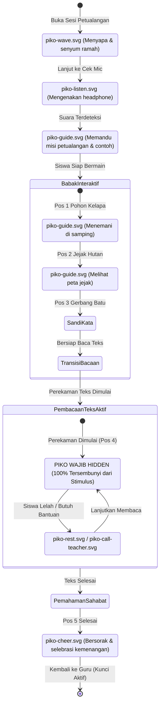

# Dyscovery Design System

**Versi:** 1.3, integrasi modul petualangan gamifikasi & arsitektur final  
**Tanggal:** 27 Oktober 2026  
**Tagline:** Kenali risiko, temukan dukungan.  
**Status:** Spesifikasi desain antarmuka, modul petualangan gamifikasi, token visual, komponen, dan pedoman aksesibilitas final yang disepakati.

Acuan: [PRD](Dyscovery-PRD.md), [Workflow](Dyscovery-Workflow.md), [ERD](Dyscovery-ERD.md), dan [Security Rules](Dyscovery-Security-Rules.md).

---

## 1. Tujuan dan Batas Desain

Dyscovery menghadirkan antarmuka web modern yang ramah anak sekaligus profesional untuk mendukung pengamatan literasi dan skrining awal risiko disleksia kelas 2 SD di sekolah.

- **Modul Petualangan Interaktif Gamifikasi (*Dora-Style Adventure*):** Asesmen dibingkai dalam perjalanan penjelajahan hutan ajaib bersama Maskot Piko (mencari buah kelapa bertuliskan huruf, menyusun ubin kata, membaca sandi gerbang batu, dan membaca prasasti cerita). Desain ini menghapus kecemasan ujian anak tanpa mengorbankan ketepatan pengamatan klinis.
- **Integritas Penilaian Membaca:** Pada saat anak membaca lisan (kata atau teks narasi), antarmuka secara elegan beralih ke tampilan kartu stimulus membaca yang tenang, bersih, dan berlatar stabil (**Nunito Sans 26–28px** di atas `#FAF8F4`). Elemen animasi dan Maskot Piko disembunyikan sepenuhnya agar pandangan mata anak tidak terdistraksi.
- **Model Perangkat Tunggal (Single Teacher Device):** Sistem beroperasi pada satu perangkat laptop/desktop guru (**1440×900px**) di ruang kelas. Desain antarmuka mengintegrasikan alur kerja guru dan **Mode Siswa Sementara (*Student Mode*)** pada perangkat yang sama dengan penguncian akses server (*Student Access Lock*).
- **Asisten Draf Guru (Drafting Assistant):** Antarmuka peninjauan (*Teacher Verification Split-View*) menyelaraskan visual *waveform* audio dengan teks anotasi draf AI pascarekaman (2–15 detik), memangkas waktu kerja manual guru hingga 80–90%.
- **Direktori Psikolog Terverifikasi:** Menyediakan komponen kartu profil profesional terstandar bagi orang tua untuk membagikan laporan observasi sekolah secara berbatas waktu (*time-bound access*) guna memfasilitasi diagnosis klinis resmi.

---

## 2. Spesifikasi Layar Kerja: 100% Desktop Web Focus (1440×900px)

- **Target Resolusi Utama:** **Desktop / Laptop 1440×900px** (rasio 16:10 / 16:9), standar perangkat komputer sekolah di Indonesia.
- **Alasan Fokus Desktop Penuh:**
  1. Menjamin stabilitas pemenggalan baris kata (*line wrapping*) pada kartu bacaan siswa agar tidak terjadi bias kesulitan membaca akibat layar sempit ponsel.
  2. Memberikan ruang kanvas luas untuk elemen visual petualangan hutan (peta jalan, ubin huruf buah kelapa, dialog Piko) yang proporsional.
  3. Menyediakan ruang kerja ergonomis bagi guru saat meninjau hasil pada antarmuka *split-view* (pemutar audio dengan visualisasi *waveform* berdampingan dengan teks acuan).
  4. Menjamin keandalan input audio melalui mikrofon laptop/headset USB sekolah tanpa gangguan *system interrupt* khas perangkat ponsel (panggilan telepon, notifikasi aplikasi, atau penguncian layar otomatis).
- Dashboard orang tua dan direktori psikolog tetap mengadopsi tata letak responsif adaptif untuk kemudahan akses peramban umum.

---

## 3. Brand Design Tokens & Palet Warna

| Token Token | Nama Warna | Nilai HEX | Kontras (WCAG) | Penggunaan Utama |
|---|---|---|---|---|
| `primary` | Biru Tinta | `#24476A` | 9.2:1 thd background | Tombol utama, tautan aktif, navigasi bar, indikator fokus keyboard |
| `accent` | Aprikot | `#F2B880` | 3.2:1 thd foreground | Lencana progres, aksen ilustrasi ramah anak, ubin huruf buah kelapa |
| `background` | Putih Hangat | `#FAF8F4` | Kanvas dasar | Latar belakang seluruh halaman web dan kanvas kartu stimulus bacaan |
| `surface` | Putih Bersih | `#FFFFFF` | 1.1:1 thd background | Permukaan kartu evaluasi, modal dialog, panel *split-view*, dan lembar laporan |
| `foreground` | Arang Kebiruan | `#202C38` | 13.5:1 thd background | Teks stimulus bacaan siswa, judul halaman, label instruksi penting |

### Palet Nuansa Petualangan Hutan (*Forest Theme Accents*)
- **Forest Canopy (Hijau Hutan):** `#2D5A27` — Garis bingkai modul petualangan, dedaunan latar belakang statis.
- **Trail Earth (Cokelat Tanah):** `#8D6E63` — Garis jalan setapak pada peta petualangan Pos 1 s/d Pos 5.
- **Coconut Shell (Kuning Aprikot Kayu):** `#E6A15C` — Warna ubin interaktif buah kelapa pada babak susun huruf.

### Warna Semantik & Status
- **Success (Selesai/Cocok):** `#2E7D32` (latar lembut `#E8F5E9`) — Menandai kata terbaca lancar atau tugas tuntas.
- **Warning (Keraguan/Substitusi):** `#ED6C02` (latar lembut `#FFF4E5`) — Menandai kandidat substitusi fonem atau jeda panjang anak.
- **Danger (Gagal/Terlewat):** `#D32F2F` (latar lembut `#FFEBEE`) — Menandai kata terlewat (*omission*) atau kesalahan unggah audio.
- **Neutral / Unclear (Belum Dinilai):** `#607D8B` (latar lembut `#ECEFF1`) — Menandai segmen audio tidak jelas atau butir yang dilewati tanpa vonis salah.

*Catatan: Seluruh status antarmuka wajib menyertakan ikon dan label teks penjelas; warna tidak pernah digunakan sebagai satu-satunya indikator.*

---

## 4. Tipografi

**Font Utama: Nunito Sans (Google Fonts)**  
Nunito Sans dipilih karena memiliki bentuk huruf melengkung (*rounded terminal*) yang bersahabat bagi anak kelas 2 SD, ketegasan garis yang bersih untuk mencegah ambiguitas karakter (seperti pembedaan jelas antara huruf `b`, `d`, `p`, `q`, `l`, `I`, dan `1`), serta kenyamanan pembacaan teks panjang oleh guru dan psikolog.

### Skala Tipografi Sistem

| Tingkat Hirarki | Ukuran Font | Line-Height | Bobot (Weight) | Penggunaan |
|---|---|---|---|---|
| **Display Reading** | **26–28 px** | **1.6 (42–45 px)** | **Regular (400) / Semibold (600)** | **Kartu Stimulus Membaca Siswa** |
| Adventure Prompt | 22–24 px | 1.4 (31–34 px) | Semibold (600) | Instruksi Misi Babak Petualangan (Pos 1–3) |
| Page Heading (H1) | 28–32 px | 1.3 (36–42 px) | Bold (700) | Judul Halaman Dashboard & Laporan |
| Section Heading (H2) | 20–24 px | 1.4 (28–34 px) | Bold (700) | Judul Bagian, Kartu Modul, Nama Psikolog |
| Subheading (H3) | 18–20 px | 1.4 (25–28 px) | Semibold (600) | Label Panel Peninjauan, Subjudul Bagian |
| Body Regular | 16–18 px | 1.5 (24–27 px) | Regular (400) | Teks Paragraf Laporan, Deskripsi Instruksi |
| Body Semibold | 16–18 px | 1.5 (24–27 px) | Semibold (600) | Label Formulir, Teks Tombol Utama |
| Caption & Badge | 13–14 px | 1.4 (18–20 px) | Semibold (600) | Kredensial STR/NIP, Tag Metadata, Timestamp |

### Aturan Tipografi Stimulus Membaca Siswa
- **Ukuran Wajib 26–28px:** Memastikan keterbacaan optimal dari jarak pandang laptop meja guru (sekitar 50–70 cm).
- **Rata Kiri Murni (*Left-Aligned*):** Dilarang keras menggunakan rata kanan-kiri (*justified*) untuk mencegah celah spasi yang tidak merata (*rivers of white space*).
- **Line-Height Lebar (1.6):** Menjaga jarak vertikal yang cukup antarbaris guna meminimalkan risiko anak melompati baris (*line skipping*).
- **Letter-Spacing Normal:** Menghindari *tracking* yang terlalu renggang atau terlalu rapat.
- **Bebas Distraksi Font Pixel:** Font pixel-art hanya diperbolehkan pada elemen dekoratif lingkungan modul petualangan, **TIDAK PERNAH** digunakan pada teks stimulus membaca anak.

---

## 5. Komponen Modul Petualangan & Kartu Stimulus Bacaan

### 5.1 Elemen Petualangan Gamifikasi (Pos 1–3 & Pos 5)
- **Bingkai Hutan Pixel-Art:** Tepi layar dihiasi grafis dedaunan dan latar hutan pixel-art yang lembut dengan kontras rendah sehingga tidak menyilaukan mata anak.
- **Ubin Huruf Buah Kelapa (*Coconut Letter Tiles*):**
  - Ubin berukuran minimal 56 × 56 px dengan sudut membulat, berlatar warna Aprikot Kayu (`#E6A15C`) dan teks Arang Kebiruan 24px Bold.
  - Dapat diklik atau disentuh dengan mudah untuk dipindahkan ke kotak susunan kata.
- **Balon Dialog Petualangan Piko:** Kotak pesan ramah berlatar Putih Bersih dengan lis Biru Tinta 2px dan sudut melengkung 16px, menampilkan teks instruksi ramah bernada eksploratif (*"Yuk bantu Piko mencari 3 kelapa huruf!"*).

### 5.2 Kartu Stimulus Membaca Teks (Pos 4: Oral Reading Screening)
Saat memasuki pembacaan teks lisan aktif, elemen permainan disederhanakan secara dramatis demi integritas klinis:
- **Kontainer Terpusat:** Kartu bacaan memiliki lebar tetap (*fixed max-width 840px*), berlatar Putih Bersih (`#FFFFFF`) di atas kanvas Putih Hangat (`#FAF8F4`), dengan sudut membulat halus (*border-radius: 16px*) dan bayangan lembut (*subtle elevation* `0 4px 20px rgba(32, 44, 56, 0.06)`).
- **Kestabilan Penuh (No Real-Time Moving Elements):**
  - **TIDAK ADA** penanda kata bergerak (*bouncing ball*).
  - **TIDAK ADA** perubahan warna kata secara *real-time* mengikuti ucapan suara.
  - **TIDAK ADA** notifikasi benar/salah saat membaca.
- **Indikator Perekaman Minimalis:** Titik lampu merah statis/berkedip sangat lambat (*slow pulse*) di sudut kanan atas kartu dengan teks label "Merekam suara..." untuk kepastian teknis guru.

---

## 6. Aturan Integrasi Maskot Piko (Piko Mascot Visibility Rules)

Maskot Piko (karakter panda merah ramah berformat SVG orisinal) berperan sebagai pendamping emosional anak sepanjang petualangan. Kehadiran Piko diatur secara ketat berdasarkan tahapan sesi:



### Tabel Rincian Status Maskot Piko

| Fase Sesi | Aset Berkas | Perilaku & Posisi Visual | Aturan Desain |
|---|---|---|---|
| **Sambutan (*Welcome*)** | `piko-wave.svg` | Berdiri di samping teks pembuka; melambaikan tangan | Menciptakan suasana tenang, ramah, dan tidak menegangkan. |
| **Cek Suara (*Soundcheck*)** | `piko-listen.svg` | Memakai headphone; telinga bergerak saat anak bersuara | Memberi umpan balik interaktif bahwa mikrofon menangkap suara anak. |
| **Latihan Petualangan (*Practice*)** | `piko-guide.svg` | Berada di samping kartu latihan memegang penunjuk panduan | Menjelaskan alur babak petualangan contoh non-skrining tanpa tekanan nilai. |
| **Babak Susun Huruf & Kata** | `piko-guide.svg` | Berdiri di pojok kiri bawah layar di luar area klik ubin | Memberikan dukungan visual ramah saat menyusun ubin kelapa atau mengeja gambar. |
| **Skrining Membaca Teks Aktif** | **DISEMBUNYIKAN (HIDDEN)** | **DOM: `display: none` / `visibility: hidden`** | **CRITICAL:** Dilarang keras menampilkan maskot atau animasi apa pun selama membaca teks untuk mencegah distraksi visual dan kecemasan siswa. |
| **Jeda / Istirahat (*Pause*)** | `piko-rest.svg` | Duduk santai memegang botol minum | Muncul hanya jika tombol jeda ditekan, menandakan sesi berhenti sementara. |
| **Panggil Guru (*Help*)** | `piko-call-teacher.svg` | Melambaikan lonceng panggil guru | Menghilangkan rasa takut anak saat membutuhkan bantuan teknis guru. |
| **Misi Tuntas (*Completion*)** | `piko-cheer.svg` | Melompat gembira dengan bintang-bintang selebrasi | Memberikan apresiasi emosional positif atas keberhasilan misi petualangan anak. |

---

## 7. Antarmuka Peninjauan Guru: Teacher Verification Split-View (1440×900px)

Antarmuka ini dirancang untuk memaksimalkan efisiensi guru pascaskrining, memangkas 80–90% waktu transkripsi manual:

```
+---------------------------------------------------------------------------------------------------+
|  DYSCOVERY - VERIFIKASI BACAAN SISWA                                    [Kembali] [Simpan Revisi] |
+---------------------------------------------------------------------------------------------------+
|  Siswa: Budi Santoso (Kelas 2)  |  Materi: M-LIT-02 v1  |  Status AI: Selesai (Latensi: 4.2s)     |
+---------------------------------------------------------------------------------------------------+
|                                                                                                   |
|  [ PANEL KIRI: AUDIO VAULT & WAVEFORM ]          |  [ PANEL KANAN: TEKS STIMULUS & ANOTASI DRAF ] |
|                                                  |                                                |
|  +--------------------------------------------+  |  Teks Acuan & Hasil Analisis AI:               |
|  | [Play/Pause]  00:14 / 00:45    [Speed: 1x] |  |                                                |
|  |  ||||||||||||||||||||||||||||||||||||||||  |  |  "Pada suatu hari di sebuah [hutan] rimba,     |
|  |  ^^^^^^^^^^^^^^^^^^^^^^^^^^^^^^^^^^^^^^^^  |  |   ada seekor kancil yang sangat [cerdik]..."   |
|  +--------------------------------------------+  |                                                |
|                                                  |  Kandidat Anotasi AI:                          |
|  Segmen Terpilih: 00:08 - 00:11                  |  - [hutan] -> AI: "hutan" (Cocok, 98%)         |
|  [Loop Segmen]  [Putar Ulang 2 Detik Terakhir]   |  - [cerdik] -> AI: "ce-dik" (Keraguan/Subst)   |
|                                                  |                                                |
|  Catatan Guru:                                   |  Tindakan Verifikasi Cepat (Quick Action):     |
|  [  Anak sempat berhenti batuk sebentar    ]     |  [v Konfirmasi Draf AI]  [x Koreksi Anotasi]   |
|                                                  |  [+ Tambah Catatan Guru]                       |
+---------------------------------------------------------------------------------------------------+
```

### Fitur Utama Split-View
1. **Interactive Audio Waveform:** Waveform kanvas visual yang dapat diklik pada titik detik mana pun untuk melompat langsung ke audio segmen kata terkait.
2. **Synchronized Word Highlighting (Teacher Side Only):** Mengklik kata pada panel kanan secara otomatis mengarahkan pemutar audio ke rentang waktu kata tersebut (`audio_start_ms` s/d `audio_end_ms`).
3. **Pembedaan Asal Anotasi (*Provenance Badging*):**
   - Anotasi usulan AI diberi lencana `[Draf AI]`.
   - Anotasi yang telah diverifikasi guru berubah menjadi `[Terverifikasi Guru]`.
   - Anotasi manual murni guru ditandai `[Catatan Manual]`.
4. **Pintasan Keyboard (*Keyboard Shortcuts*):** Tombol `Space` untuk putar/jeda, `Tab` untuk berpindah antarkata bertanda, dan `Enter` untuk konfirmasi cepat draf AI.

---

## 8. Komponen Direktori Psikolog Terverifikasi

Komponen ini memfasilitasi peran rujukan klinis diagnosis resmi oleh orang tua:

### 8.1 Kartu Profil Psikolog (*Psychologist Profile Card*)
Setiap kartu profil dalam direktori menampilkan struktur data terverifikasi:
- **Foto Profil / Avatar:** Foto resmi psikolog (`avatar_url`), berbentuk lingkaran dengan diameter 72px dan lis penanda verifikasi biru tinta.
- **Nama Lengkap & Gelar:** Nama lengkap profesional (contoh: *Dra. Anita Wijaya, M.Psi., Psikolog*).
- **Nomor Kredensial Resmi (*Credential Badge*):** Lencana berlatar biru lembut menampilkan nomor STR (*Surat Tanda Registrasi Tenaga Kesehatan*) atau NIP resmi yang telah tervalidasi oleh sistem.
- **Nama Klinik / Institusi:** Nama instansi tempat praktik resmi (contoh: *Klinik Tumbuh Kembang Harapan Kita* / *Biro Psikologi Terpadu*).
- **Lokasi & Kontak:** Kota praktik dan opsi sesi konsultasi.
- **Tombol Aksi Utama:** Tombol Primer (`#24476A`) bertuliskan *"Pilih Konsultasi & Bagikan Laporan"*.

### 8.2 Modal Pengaturan Izin Berbagi Berbatas Waktu (*Time-Bound Access Modal*)
Saat orang tua memilih psikolog:
1. **Pilihan Versi Laporan:** Menampilkan daftar versi laporan resmi (`REPORT_VERSION`) yang telah diterbitkan guru.
2. **Batas Waktu Akses (*Time-Bound Access*):** Pemilih tanggal kedaluwarsa akses (*default:* 30 hari kalender). Setelah melewati tanggal tersebut, akses psikolog tertutup otomatis oleh server.
3. **Pengecualian Rekaman Audio:** Opsi pembagian rekaman audio mentah secara *default* berstatus tidak tercentang (*unchecked*) demi menjaga privasi suara anak, kecuali jika orang tua sengaja mengaktifkannya.
4. **Tombol Konfirmasi Aman:** Tombol tindakan mencatat *event* izin baru ke dalam `REPORT_SHARE` dan membuat permohonan ke `CONSULTATION_REQUEST`.

---

## 9. Pedoman Aksesibilitas (WCAG 2.1 Level AA)

1. **Rasio Kontras Warna Minimum:**
   - Seluruh teks normal (kurang dari 24px) memenuhi kontras minimal **4.5:1** terhadap warna latarnya.
   - Teks besar (24px ke atas, termasuk teks kartu stimulus 26–28px) memenuhi kontras minimal **3:1** (kontras teks Arang Kebiruan `#202C38` terhadap Putih Hangat `#FAF8F4` mencapai **13.5:1**, jauh melampaui standar).
2. **Fokus Keyboard Terlihat Jelas (*Visible Focus Ring*):**
   - Seluruh elemen interaktif (tombol, tautan, input, ubin huruf kelapa) memiliki *focus outline* berupa garis solid 2px warna Biru Tinta (`#24476A`) dengan jarak *offset* 2px (`outline: 2px solid #24476A; outline-offset: 2px;`).
3. **Target Sentuh dan Klik Ergonomis:**
   - Semua tombol tindakan utama, kontrol pemutar audio, ubin huruf buah kelapa (minimal 56×56px), dan navigasi memiliki area klik minimal **44 × 44 CSS px**.
4. **Dukungan Pembaca Layar (*Screen Reader Accessibility*):**
   - Tombol ikon dilengkapi dengan `aria-label` eksplisit (misal: `aria-label="Putar rekaman audio"` atau `aria-label="Tutup jendela dialog"`).
   - Indikator status memiliki teks pendamping tersembunyi (*visually hidden text*) untuk pengguna screen reader.
5. **Penghormatan Pengurangan Gerak (*prefers-reduced-motion*):**
   - Animasi transisi halaman dan pergerakan maskot Piko menghormati preferensi sistem operasi pengguna. Jika `prefers-reduced-motion: reduce` aktif, seluruh durasi transisi diatur menjadi 0ms.

---

## 10. Checklist Verifikasi Desain Sebelum Rilis

- [ ] **Modul Petualangan Interaktif Terintegrasi:** Tema petualangan hutan (Pos 1–5, ubin huruf kelapa, tebak gambar) dirancang ramah anak tanpa visual yang memicu stres.
- [ ] **Spesifikasi Desktop 1440×900px:** Seluruh tampilan guru dan mode siswa diuji tampil proporsional tanpa *layout breaking* pada resolusi 1440×900px.
- [ ] **Kepatuhan Brand Tokens:** Menggunakan warna Biru Tinta (`#24476A`), Aprikot (`#F2B880`), Putih Hangat (`#FAF8F4`), dan Arang Kebiruan (`#202C38`).
- [ ] **Stimulus Membaca Tenang:** Kartu bacaan berlatar `#FAF8F4` dengan font Nunito Sans 26–28px rata kiri, line-height 1.6, dan tanpa animasi teks yang melompat.
- [ ] **Visibilitas Piko 100% Teruji:** Maskot Piko tampil pada fase Sambutan, Cek Suara, Latihan/Petualangan, Jeda, dan Tuntas, serta **terbukti 100% tersembunyi dari stimulus** selama pembacaan teks aktif.
- [ ] **Teacher Verification Split-View:** Tersedia antarmuka pemutar audio waveform yang tersinkronisasi dengan penyorotan kata draf AI, memangkas beban kerja manual guru 80–90%.
- [ ] **Direktori Psikolog Terstandar:** Menampilkan kartu profil psikolog dengan data kredensial lengkap (Avatar, Nama, STR/NIP, Fasilitas Klinik).
- [ ] **Modal Berbagi Berbatas Waktu:** Formulir berbagi laporan menyediakan pengaturan tanggal kedaluwarsa eksplisit dan pengecualian audio secara default.
- [ ] **Kepatuhan WCAG AA:** Rasio kontras teks, target klik minimal 44×44px, dan cincin fokus keyboard terverifikasi pada seluruh alur pengguna.
