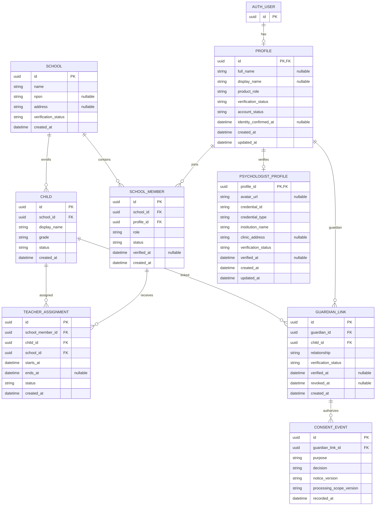
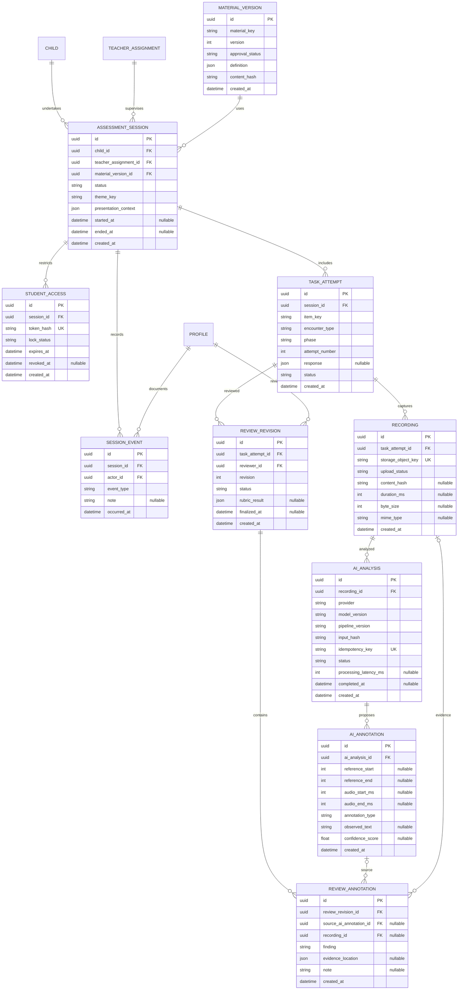
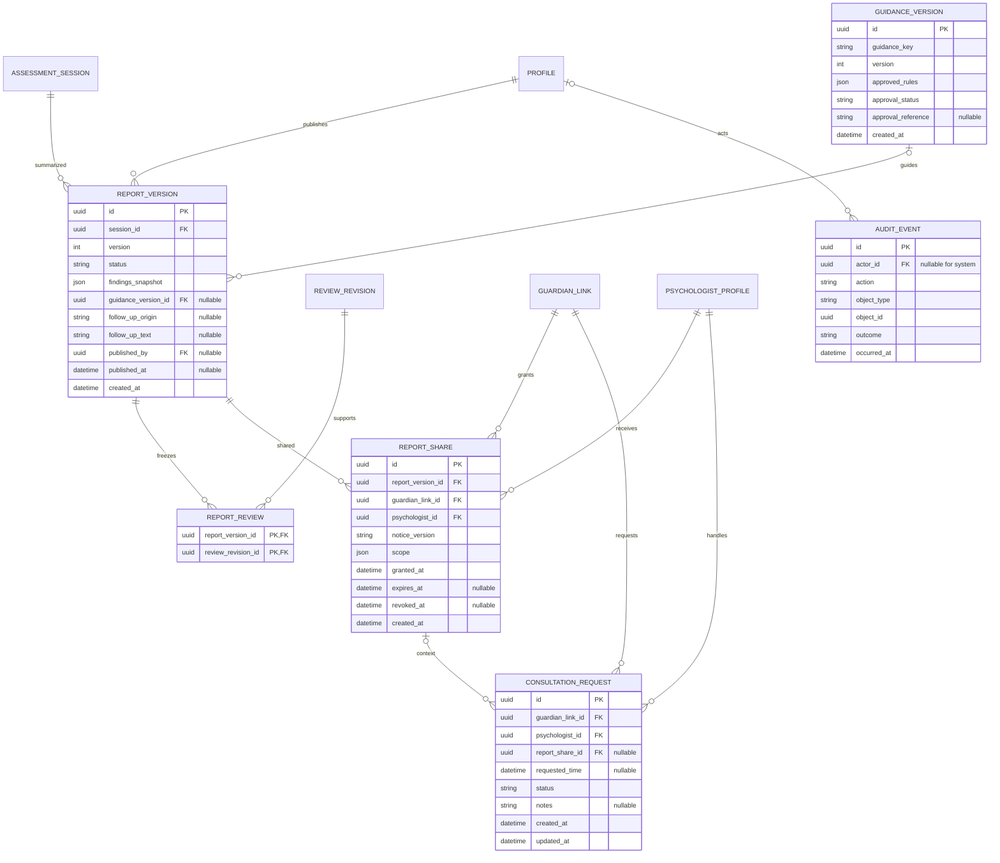

# Dyscovery: Entity Relationship Diagram

**Versi:** 1.3, integrasi modul petualangan gamifikasi & arsitektur final  
**Tanggal:** 27 Oktober 2026  
**Tagline:** Kenali risiko, temukan dukungan.  
**Status:** Rancangan skema data logis final yang disepakati untuk implementasi database Supabase PostgreSQL.

Acuan: [PRD](Dyscovery-PRD.md), [Workflow](Dyscovery-Workflow.md), [Design System](Dyscovery-Design-System.md), dan [Security Rules](Dyscovery-Security-Rules.md).

---

## 1. Notasi dan Keputusan Pemodelan Arsitektur

- **Notasi Hubungan:** `||`: tepat satu; `o|`: nol atau satu; `o{`: nol atau banyak; `|{`: satu atau banyak.
- **Tipe Kunci:** `PK`: Primary Key (UUID v4 default); `FK`: Foreign Key; `UK`: Unique Constraint.
- **Atribut Nullable:** Field bertanda `"nullable"` diperbolehkan bernilai NULL sesuai siklus hidup entitas.
- **Modul Petualangan Gamifikasi (*Adventure Gamification Encounters*):**
  - Entitas `MATERIAL_VERSION.definition` menyimpan struktur narasi petualangan, dialog cerita, jenis babak (*letter_arrange*, *spelling_image*, *word_read*, *passage_read*, *comprehension*), kunci stimulus, dan rubrik penilaian.
  - Entitas `TASK_ATTEMPT` mengakomodasi berbagai jenis respons interaktif siswa (susunan ubin huruf, pilihan visual, atau penanda tugas lisan) melalui atribut `response` (JSON) dan status pengerjaan.
- **Model Perangkat Tunggal (Single Teacher Device):** Siswa **TIDAK** memiliki akun pengguna (`auth.users`) atau profil relasional. `STUDENT_ACCESS` adalah kapabilitas sesi sementara dengan *token hash* yang terkunci di sisi server (*Server-Side Student Access Lock*) pada laptop/desktop guru (1440×900px).
- **Analisis AI Pascarekaman Murni (Post-Recording 2–15 Detik):** Model data secara eksplisit **TIDAK MEMILIKI TABEL STREAMING REAL-TIME**, tidak ada tabel *audio chunking*, dan tidak ada tabel *live alignment socket*. Pemrosesan AI dimulai hanya setelah entitas `RECORDING` berstatus `ready` di Supabase Private Storage.
- **Asisten Draf Guru (Drafting Assistant):** Relasi antara `AI_ANNOTATION` dan `REVIEW_ANNOTATION` menghubungkan draf usulan AI ke keputusan verifikasi guru pada antarmuka *split-view*, memangkas waktu kerja manual guru hingga 80–90%.
- **Direktori Psikolog Terverifikasi:** Entitas `PSYCHOLOGIST_PROFILE` menyimpan data publik terstandar (Avatar URL, Nama Lengkap, Nomor Kredensial STR/NIP, Nama Fasilitas/Klinik) untuk ditampilkan pada komponen kartu direktori.
- **Izin Berbagi Berbatas Waktu (Time-Bound Access):** Entitas `REPORT_SHARE` mencatat izin pembagian laporan observasi dari orang tua kepada psikolog tertentu, mengikat versi laporan spesifik dengan tanggal kedaluwarsa (`expires_at`), serta mengecualikan rekaman audio secara default.
- **Target Operasional Rp0:** Struktur skema dioptimalkan untuk berjalan pada Supabase PostgreSQL Free Tier dengan Row Level Security (RLS) terisolasi.

---

## 2. ERD Identitas, Sekolah, Penugasan, dan Persetujuan

Bagian ini mengelola pengguna dewasa (Guru, Orang Tua, Psikolog), sekolah, penugasan siswa, hubungan perwalian, serta pencatatan persetujuan (*immutable consent*).

### Aturan Integritas Identitas dan Persetujuan
1. `PROFILE.product_role`: Dibatasi nilai `'teacher'`, `'guardian'`, atau `'psychologist'`. Siswa tidak memiliki profil.
2. `CHILD.grade`: Dibatasi nilai `'2'` untuk cakupan MVP kelas 2 SD.
3. `TEACHER_ASSIGNMENT`: Mengikat `(school_member_id, child_id, school_id)` untuk memastikan guru dan siswa berada di sekolah yang sama. Penugasan harus berstatus `'active'` agar guru dapat menginisiasi sesi asesmen.
4. `PSYCHOLOGIST_PROFILE`: Menyimpan data kredensial profesional:
   - `credential_id`: Nomor Surat Tanda Registrasi (STR) Psikolog Klinis atau NIP resmi.
   - `credential_type`: Jenis kredensial (misalnya `'STR_PSIKOLOG_KLINIS'` atau `'NIP_INSTITUSI'`).
   - `institution_name`: Nama fasilitas layanan psikologi, rumah sakit, atau biro konsultasi terdaftar.
   - `avatar_url`: Tautan berkas foto profil resmi yang disajikan pada kartu Direktori Psikolog.
5. `CONSENT_EVENT`: Tabel *append-only* yang mencatat persetujuan orang tua secara granular:
   - `purpose`: `'activity'` (kegiatan petualangan literasi), `'recording'` (perekaman audio digital), dan `'ai_processing'` (analisis AI pascarekaman).
   - `decision`: `'grant'` (diberikan), `'deny'` (ditolak), atau `'withdraw'` (dicabut).
   - Penolakan izin AI tidak menghambat pelaksanaan sesi membaca atau peninjauan manual guru.

---

## 3. ERD Materi, Petualangan, Sesi, Rekaman, dan Verifikasi Guru

Bagian ini memodelkan materi petualangan interaktif yang bersifat immutable, sesi asesmen pada perangkat guru, tugas interaktif (*task attempt*), penyimpanan berkas audio, analisis AI pascarekaman (2–15 detik), dan antarmuka peninjauan guru (*split-view*).

### Aturan Integritas Sesi, Petualangan, Audio, dan Verifikasi Guru
1. `STUDENT_ACCESS`: Mengimplementasikan *Server-Side Student Access Lock*. Saat `lock_status = 'locked'`, API server menolak seluruh permintaan berprivilege guru. Membuka kunci membutuhkan PIN/re-autentikasi guru (`revoked_at` terisi).
2. `MATERIAL_VERSION`: Bersifat *immutable*. Definisi babak petualangan gamifikasi (dialog Piko, ubin huruf buah kelapa, stimulus kata/teks Nunito Sans 26–28px) dan rubrik penilaian tersimpan dalam format JSON dengan hash validasi (`content_hash`).
3. `TASK_ATTEMPT`:
   - `encounter_type`: `'letter_arrange'` (menyusun huruf buah kelapa), `'spelling_image'` (mengeja gambar jejak), `'word_read'` (membaca kata nyata/semu), `'passage_read'` (membaca teks lisan), atau `'comprehension'` (pemahaman sahabat hutan).
   - `phase`: Dibatasi `'practice'` (latihan bersama Piko, tidak masuk skor) atau `'screening'` (skrining resmi).
   - `response`: JSON fleksibel menyimpan susunan huruf, pilihan ganda, atau status rekaman audio.
4. `RECORDING`:
   - Menyimpan referensi berkas audio privat pada Supabase Storage (`storage_object_key`) khusus tugas membaca lisan.
   - `upload_status`: `'pending'`, `'uploading'`, `'ready'`, `'failed'`, atau `'deleted'`.
   - Audio yang terputus atau gagal unggah tidak boleh dianggap sebagai kesalahan membaca siswa.
5. `AI_ANALYSIS`:
   - **Strictly Post-Recording:** Hanya dapat diinisiasi ketika `RECORDING.upload_status = 'ready'`.
   - `status`: `'queued'`, `'running'`, `'completed'`, `'failed'`, atau `'cancelled'`.
   - `processing_latency_ms`: Mencatat durasi inferensi model (ditargetkan dalam rentang 2.000 ms hingga 15.000 ms).
   - Menggunakan `idempotency_key` untuk mencegah pemrosesan ganda pada rekaman yang sama.
6. `AI_ANNOTATION`:
   - Draf kandidat anotasi yang diselaraskan dengan garis waktu audio (`audio_start_ms`, `audio_end_ms`) dan rentang karakter teks stimulus (`reference_start`, `reference_end`).
   - `annotation_type`: `'match'`, `'substitution'`, `'omission'`, `'repetition'`, `'hesitation'`, atau `'unclear'`.
7. `REVIEW_REVISION` & `REVIEW_ANNOTATION`:
   - Antarmuka *Teacher Verification Split-View* memetakan `source_ai_annotation_id` ke anotasi yang divalidasi atau dikoreksi guru.
   - Mengurangi beban transkripsi guru sebesar 80–90%. Guru memfinalisasi hasil evaluasi menjadi `REVIEW_REVISION` yang bersifat *immutable* setelah status `'finalized'`.

---

## 4. ERD Laporan, Pedoman, Berbagi, dan Konsultasi

Bagian ini memodelkan laporan observasi sekolah, penerapan pedoman tindak lanjut berbasis aturan, Direktori Psikolog, pembagian data berbatas waktu, dan permohonan konsultasi klinis.

### Aturan Integritas Laporan, Berbagi, dan Konsultasi
1. `REPORT_VERSION`:
   - Diterbitkan oleh guru yang berwenang (`published_by`).
   - `findings_snapshot`: Menyimpan data permanen performa babak petualangan dan observasi membaca lisan (akurasi, pola fonologis, durasi baca, catatan pendampingan) tanpa vonis diagnosis otomatis disleksia.
   - `status`: `'draft'` atau `'published'`. Begitu diterbitkan, baris ini bersifat *immutable*. Koreksi berikutnya menghasilkan nomor versi baru (`version = version + 1`).
2. `GUIDANCE_VERSION`:
   - Mengatur saran tindak lanjut pedagogis sekolah secara deterministik berbasis aturan (*rule-based decision tree*), **BUKAN menggunakan Generative AI / LLM**.
   - Setiap narasi saran wajib telah disetujui tim ahli pendidikan dan psikologi (`approval_status = 'approved'`).
3. `REPORT_SHARE` (Izin Berbagi Berbatas Waktu):
   - Menghubungkan orang tua (`guardian_link_id`) dengan psikolog klinis terverifikasi (`psychologist_id`) dari direktori.
   - `expires_at`: Wajib ditentukan untuk membatasi masa akses psikolog (*time-bound access*, misalnya 30 hari kalender).
   - `scope`: JSON yang membatasi hak baca:
     - Hanya versi laporan yang dipilih (`report_version_id`).
     - Berkas rekaman audio mentah (`RECORDING`) secara *default* dikecualikan (`"include_audio": false`) kecuali diaktifkan secara eksplisit oleh orang tua.
   - `revoked_at`: Menghentikan akses seketika jika orang tua mencabut izin sebelum batas kedaluwarsa.
4. `CONSULTATION_REQUEST`:
   - Permohonan jadwal konsultasi klinis awal dari orang tua kepada psikolog yang dipilih dari direktori.
   - `status`: `'pending'`, `'accepted'`, `'declined'`, atau `'completed'`.
   - Konsultasi dan percakapan psikologis tidak dapat diakses atau dilihat oleh pihak guru sekolah untuk menjaga kerahasiaan medis.
5. `AUDIT_EVENT`:
   - Jejak audit *append-only* yang mencatat setiap peristiwa akses data laporan anak, perubahan izin, pembagian laporan ke psikolog, dan tindakan autentikasi.

---

## 5. Ringkasan Entitas Inti dan Tidak Ada Tabel Streaming

| Nama Entitas | Fungsi Utama | Keterangan Arsitektural |
|---|---|---|
| `PROFILE` | Data profil pengguna terautentikasi | Khusus Guru, Orang Tua, dan Psikolog. Siswa tidak memiliki akun. |
| `TEACHER_ASSIGNMENT` | Penugasan guru ke siswa di sekolah yang sama | Memvalidasi hak akses guru sebelum sesi skrining dibuka. |
| `CONSENT_EVENT` | Pencatat persetujuan wali murid | *Immutable consent logger* untuk kegiatan, audio, dan AI. |
| `MATERIAL_VERSION` | Paket definisi petualangan dan stimulus | Menyimpan narasi petualangan, tugas susun huruf, dan teks kartu stimulus. |
| `ASSESSMENT_SESSION` | Sesi asesmen pada single teacher device | Menyimpan konteks desktop (1440×900px), tema petualangan hutan, dan status sesi. |
| `STUDENT_ACCESS` | Kunci sesi siswa sementara | Mengisolasi akses siswa via *Server-Side Student Access Lock*. |
| `TASK_ATTEMPT` | Percobaan babak petualangan gamifikasi | Mencatat respons babak susun kelapa/huruf, eja gambar, kata, dan teks lisan. |
| `RECORDING` | Metadata berkas audio di private storage | Menyimpan referensi bucket privat, hash berkas, dan status unggah. |
| `AI_ANALYSIS` | Catatan analisis AI pascarekaman | Pemrosesan 2–15 detik tanpa streaming real-time; dilengkapi idempotency key. |
| `AI_ANNOTATION` | Usulan kandidat anotasi bacaan oleh AI | Menghasilkan draf awal untuk menghemat 80–90% waktu peninjauan guru. |
| `REVIEW_REVISION` | Hasil verifikasi dan rubrik guru | Memvalidasi usulan draf AI via *Teacher Verification Split-View*. |
| `REVIEW_ANNOTATION` | Anotasi final keputusan guru | Menyimpan bukti temuan bacaan yang diselaraskan dengan garis waktu audio. |
| `GUIDANCE_VERSION` | Pedoman saran tindak lanjut berbasis aturan | Rule-based engine approved ahli; murni tanpa Generative AI / LLM. |
| `REPORT_VERSION` | Laporan observasi resmi immutable | Dokumen hasil observasi sekolah; bukan diagnosis medis. |
| `PSYCHOLOGIST_PROFILE` | Profil psikolog dalam direktori resmi | Menyimpan avatar, nama, nomor STR/NIP, dan klinik/institusi. |
| `REPORT_SHARE` | Jembatan data aman berbatas waktu | Mengatur izin pembagian laporan ke psikolog dengan tanggal kedaluwarsa. |
| `CONSULTATION_REQUEST` | Permohonan konsultasi ke psikolog | Memfasilitasi rujukan diagnosis klinis resmi oleh psikolog berwenang. |
| `AUDIT_EVENT` | Pencatatan jejak audit sistem | Append-only; mencatat seluruh peristiwa keamanan data tanpa data rahasia. |

*Konfirmasi Arsitektur: Tidak terdapat tabel `AUDIO_STREAM_CHUNK`, `WEBSOCKET_SESSION`, `LIVE_TRANSCRIPTION`, atau `AI_CHAT_LOG` dalam database Dyscovery.*
