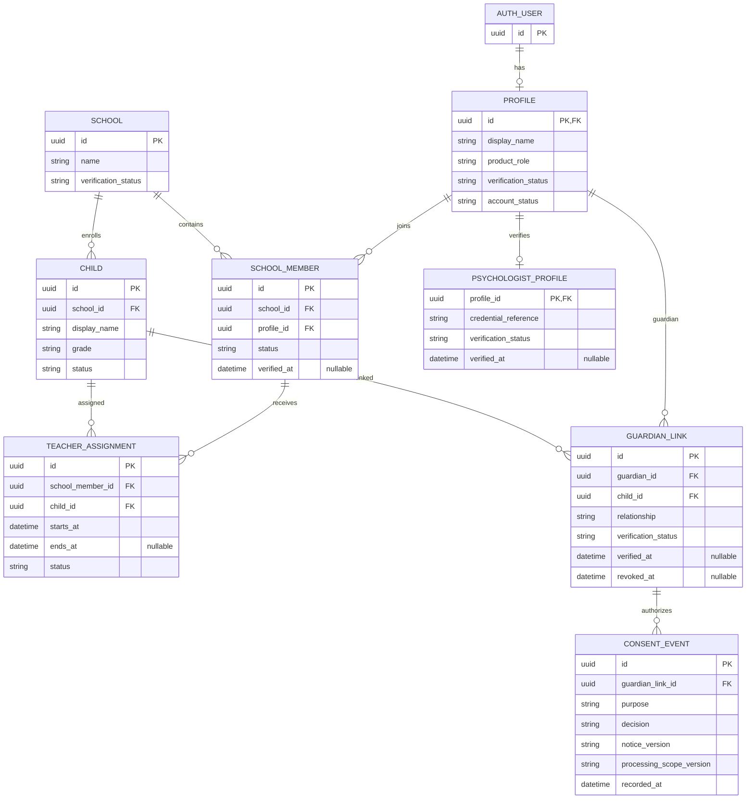
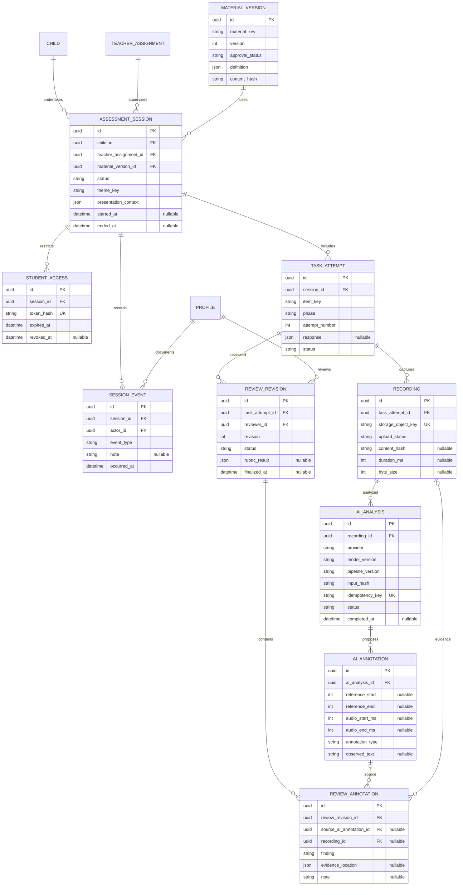
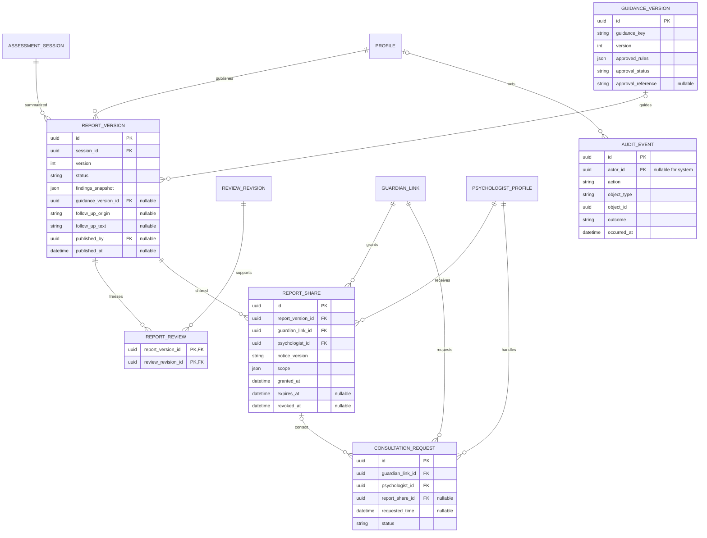

# Dyscovery: Entity Relationship Diagram

**Versi:** 1.2, baseline dokumentasi tersinkron  
**Tanggal:** 21 Oktober 2026  
**Tagline:** Kenali risiko, temukan dukungan.  
**Status:** rancangan logis awal, bukan migrasi SQL atau database yang sudah diterapkan.

Acuan: [PRD](Dyscovery-PRD.md), [Security Rules](Dyscovery-Security-Rules.md), [Design System](Dyscovery-Design-System.md), dan [Workflow](Dyscovery-Workflow.md).

Diagram menggunakan Mermaid. Buka dalam penampil Markdown yang mendukung Mermaid. Diagram dipecah menjadi tiga bagian agar terbaca; entitas bernama sama adalah tabel yang sama, bukan duplikasi.

## 1. Notasi dan keputusan pemodelan

- `PK`: primary key; `FK`: foreign key; `UK`: unik satu kolom. Constraint gabungan dijelaskan terpisah.
- `||`: tepat satu; `o|`: nol atau satu; `o{`: nol atau banyak; `|{`: satu atau banyak.
- Field bertanda komentar `nullable` boleh kosong. Field lain dimaksudkan wajib pada model awal, kecuali dijelaskan pada aturan status.
- UUID adalah usulan ID internal. Tipe dan nama belum merupakan DDL final.
- Kolom waktu umum seperti `created_at`/`updated_at` tidak diulang pada setiap tabel; implementasi tetap memerlukannya sesuai kebutuhan audit.
- Satu anak berada pada satu sekolah aktif dalam MVP. Riwayat perpindahan sekolah belum dimodelkan; sebelum menambah fitur itu, tentukan pemisahan akses terhadap data lama.
- Satu akun memiliki satu peran produk dalam MVP: guru, wali, atau psikolog. Multi-peran belum diperlukan. Operator infrastruktur bukan peran akun publik.
- Siswa tidak memiliki akun. `STUDENT_ACCESS` adalah kapabilitas sesi yang dapat dicabut, bukan akun anak.
- Identitas utama umum dan childish; hutan hanya tema modul gamifikasi. Data tema tidak memerlukan tabel tersendiri atau theme engine MVP; simpan identitas tema pada konfigurasi sesi.
- Stack: Next.js, React, TypeScript, Tailwind CSS, Node.js, Supabase, dan Vercel dengan target Rp0 sesuai ketentuan/kuota gratis. Model pretrained opsional hanya pascarekaman; training, fine-tuning, real-time, dan AI generatif saran di luar MVP.

## 2. ERD identitas, sekolah, dan persetujuan

Addendum penugasan: migrasi 003 menambahkan school_id pada TEACHER_ASSIGNMENT untuk FK gabungan (school_member_id, school_id) dan (child_id, school_id). Ini menjamin sekolah sama tanpa mengandalkan input aplikasi. CHILD.grade dibatasi '2' untuk MVP. Entitas hanya dapat diprovisikan operator pada tahap ini; guru memperoleh read siswa berdasarkan RLS, bukan akses seluruh sekolah. Migrasi/test database belum dijalankan agen.

### Addendum implementasi fondasi identitas

Migrasi `supabase/migrations/202610230001_identity.sql` menambahkan `PROFILE.full_name` (nullable sebelum onboarding) dan `identity_confirmed_at` (konfirmasi pengguna, bukan verifikasi profesi), serta `TEACHER_PROFILE(profile_id PK/FK, nip nullable)`. Timestamp created_at/updated_at tersedia pada kedua tabel. `display_name` nullable sebelum onboarding. `product_role` nullable sampai ditetapkan oleh proses berwenang; tidak diisi dari metadata OAuth. Baris profil guru dapat menyimpan data pengajuan dan tidak membuktikan role/profesi atau memberikan izin. NIP berbentuk teks 18 digit, opsional, tidak dianggap validasi pemerintah dan belum diberi constraint unik. Pengguna hanya dapat mengubah nama sendiri; perubahan full_name membatalkan konfirmasi. Penulisan konfirmasi dan NIP lewat onboarding belum diimplementasikan. Migrasi ini belum diterapkan pada staging oleh agen.

`AUTH_USER` mewakili `auth.users` yang dikelola Supabase; Dyscovery tidak menyimpan password. Tabel profil terhubung satu-ke-satu bila profil telah dibuat.

### Aturan identitas dan consent

1. `SCHOOL_MEMBER` unik untuk pasangan `(school_id, profile_id)`; hanya profil guru terverifikasi dapat menjadi guru aktif.
2. `TEACHER_ASSIGNMENT` harus menghubungkan guru dan anak pada sekolah yang sama. Ini perlu constraint/trigger atau transaksi terkontrol, bukan asumsi dari FK tunggal.
3. `GUARDIAN_LINK` unik untuk `(guardian_id, child_id)`; status aktif memerlukan verifikasi. Jangan mengumpulkan dokumen identitas mentah bila referensi verifikasi cukup.
4. `PSYCHOLOGIST_PROFILE.profile_id` hanya merujuk profil psikolog. Referensi kredensial dan bukti verifikasi memiliki akses terbatas, bukan otomatis data publik.
5. `CONSENT_EVENT` adalah catatan append-only keputusan grant/deny/withdraw. Tujuan minimum: kegiatan, rekaman, AI. Cakupan menyertakan versi pemberitahuan dan pemrosesan/penyedia agar izin lama tidak otomatis mencakup penyedia baru.
6. Backend menentukan izin efektif dari keputusan terbaru untuk hubungan, tujuan, dan cakupan yang tepat, serta validitas hubungan wali. Keputusan pemilik: semua orang tua/wali sah terverifikasi yang masih terhubung harus memberikan grant; satu wali sah cukup bila hanya satu yang terhubung. Nol wali, keputusan kosong/deny/withdraw, atau akun wali tidak aktif berarti tidak berizin. Jumlah wali tidak dipatok dua; operator wajib memverifikasi kelengkapan sesuai kondisi tiap anak dan tidak mencabut hubungan untuk melewati penolakan.
7. Pembagian laporan memakai izin spesifik di `REPORT_SHARE`, bukan consent AI yang dipakai ulang.

Addendum migrasi 004: `guardian_links` memakai relationship parent/guardian, verifikasi dan pencabutan operator. `consent_notices` mengikat tujuan, versi pemberitahuan, teks dan cakupan immutable; operator hanya dapat mengubah enabled, revisi isi harus versi baru. Tidak ada pemberitahuan nyata/AI aktif bawaan. `consent_events` append-only dengan ID bigint berurutan dan recorded_at server. RPC hanya mencatat keputusan wali sendiri; keputusan sebelum verifikasi ulang tidak digunakan. Izin harus diperiksa lagi saat operasi pemrosesan dilakukan, bukan disalin menjadi boolean permanen. Migrasi ini belum dijalankan agen pada PostgreSQL.

## 3. ERD materi, sesi, rekaman, dan peninjauan

`MATERIAL_VERSION` adalah paket materi immutable berisi stimulus/urutan tugas, rubrik, aturan bantuan, serta konfigurasi penyajian. `item_key` mengacu ke item dalam paket versi tersebut. Ini menghindari tabel bank soal yang belum dibutuhkan; bank soal relasional dapat ditambah bila pengelolaan item lintas paket diperlukan.

### Aturan sesi dan hasil

- Anak pada sesi harus sama dengan anak pada penugasan. Penugasan harus aktif saat akses diberikan; riwayat penugasan lama tetap dapat dipertahankan tanpa memberi izin aktif.
- `MATERIAL_VERSION` unik untuk `(material_key, version)`. Paket yang dipakai sesi tidak diubah di tempat. Paket latihan dan skrining memiliki item berbeda; item dan fase harus divalidasi terhadap `definition`.
- `TASK_ATTEMPT` unik untuk `(session_id, item_key, phase, attempt_number)`. Fase `practice` tidak ikut skor skrining. Respons kosong karena tugas dilewati tidak berarti salah.
- `STUDENT_ACCESS` hanya menyimpan hash rahasia, bukan token mentah; mencabut akses guru di perangkat memerlukan kontrol tambahan dan tidak otomatis diselesaikan tabel ini.
- `SESSION_EVENT` merekam bantuan guru, jeda, kendala teknis, dan penghentian. Aktor harus guru berwenang; event teknis otomatis dapat dicatat pada audit, tanpa menyamar sebagai catatan guru.
- `RECORDING` menyimpan referensi private Storage, bukan blob atau signed URL. Setelah validasi, hash mengikat input analisis. Metadata audio yang belum diketahui boleh kosong. Status minimum: pending, uploading, ready, failed, deleted.
- `AI_ANALYSIS` status minimum: queued, running, completed, failed, cancelled. Pengiriman tetap memeriksa consent dan gerbang penyedia; tidak ada analisis juga sah untuk alur manual.
- `presentation_context` mencatat konfigurasi tampilan, kelas perangkat, dan browser secukupnya untuk menelusuri penyajian; bukan fingerprint untuk pelacakan. Dashboard responsif tidak otomatis membuktikan kesetaraan asesmen antarperangkat.
- `AI_ANALYSIS` hanya dimulai setelah rekaman ready dan input tervalidasi. Model pretrained tidak dilatih/fine-tune untuk MVP. Tidak ada tabel potongan streaming, dataset pelatihan, atau job training.
- Lokasi kata/timestamp nullable: jangan mengarang bukti waktu. Gunakan rentang yang konsisten dan validasi batas terhadap materi serta durasi audio.
- `REVIEW_REVISION` unik untuk `(task_attempt_id, revision)`. Revisi final immutable; koreksi menghasilkan revisi baru. Simpan kandidat AI terpisah. Guru dapat menambah anotasi manual tanpa sumber AI.
- Jika anotasi tinjauan memiliki sumber AI atau rekaman, semuanya harus milik task attempt yang sama. FK tunggal tidak cukup untuk menjamin hal ini.
- `rubric_result` tidak boleh memuat klasifikasi yang belum disetujui. Ketidaklengkapan tetap eksplisit, bukan nilai nol.

## 4. ERD laporan, pedoman, berbagi, dan konsultasi

### Aturan laporan dan konsultasi

1. `REPORT_VERSION` unik untuk `(session_id, version)` dan immutable setelah terbit. Draf boleh direvisi sebelum terbit. Kolom penerbit/waktu wajib terisi ketika status published.
2. `REPORT_REVIEW` mengikat laporan ke revisi tinjauan tertentu dari sesi yang sama. Snapshot mempertahankan temuan, versi materi/rubrik, bantuan relevan, dan batas interpretasi saat terbit. Perubahan tinjauan tidak mengubah laporan lama.
3. `GUIDANCE_VERSION` unik untuk `(guidance_key, version)`. Saran hanya dari pedoman approved, ditinjau sebelum publikasi. Tanpa pedoman, saran dapat kosong; jangan menghasilkan rujukan otomatis dari model bebas.
4. `follow_up_origin` hanya rule/manual dalam MVP. Narasi berasal dari pedoman approved atau penulisan pihak berwenang, bukan AI generatif. Temuan laporan tidak disamakan dengan diagnosis. Penambahan AI generatif memerlukan persetujuan scope dan perubahan model data yang ditinjau.
5. `REPORT_SHARE` mengikat satu laporan, wali sah untuk anak pada laporan tersebut, dan satu psikolog terverifikasi. `scope` tidak boleh memperluas data di luar versi itu; audio dikecualikan secara default.
6. Pencabutan mempertahankan riwayat. Pemberian izin kembali membuat baris baru, bukan menghapus bukti pencabutan. Izin efektif juga memeriksa hubungan wali, akun penerima, kedaluwarsa, dan status laporan.
7. Permintaan konsultasi tidak otomatis memberikan akses laporan. `report_share_id` opsional; bila diisi, anak, wali, dan psikolog harus cocok serta izin masih aktif saat data diakses.
8. Konsultasi hanya mencakup permintaan penjadwalan dalam MVP. Pesan, catatan klinis, pembayaran, dan video tidak dimodelkan sebelum scope disetujui.
9. Audit memakai referensi objek generik, bukan FK yang menjamin semua jenis objek. Isi dibatasi, akses dikontrol, dan penghapusan data tidak boleh tanpa sengaja menghapus bukti audit yang masih wajib dipertahankan. Retensi/pseudonimisasi audit perlu kebijakan tersendiri.

## 5. Batas integritas dan implementasi

FK saja tidak menjamin role, sekolah, kepemilikan lintas tabel, persetujuan aktif, atau hak baca. Implementasi wajib menggabungkan constraint/trigger yang sesuai, transaksi server, RLS, dan kebijakan Storage. Tidak boleh ada jalur browser langsung yang melewati aturan ini.

Belum ditentukan: interval retensi, prosedur penghapusan/backup, kebijakan beberapa wali, instrumen/rubrik, provider AI yang sesuai, dan riwayat perpindahan sekolah. Jangan menerapkan cascade delete luas sebelum konsekuensi bukti, laporan, dan retensi disepakati.

Tidak dibuat tabel diagnosis/risiko otomatis, chat, billing, atau model konfigurasi generik. Tambahkan hanya ketika scope dan dasar penggunaannya tersedia.
