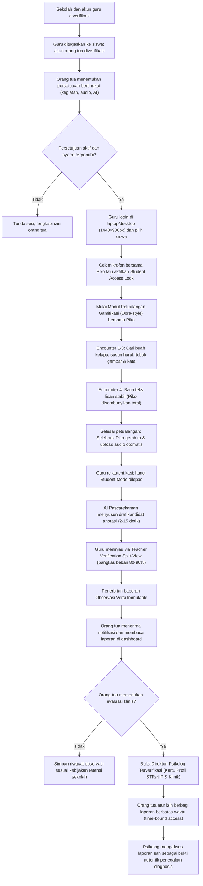
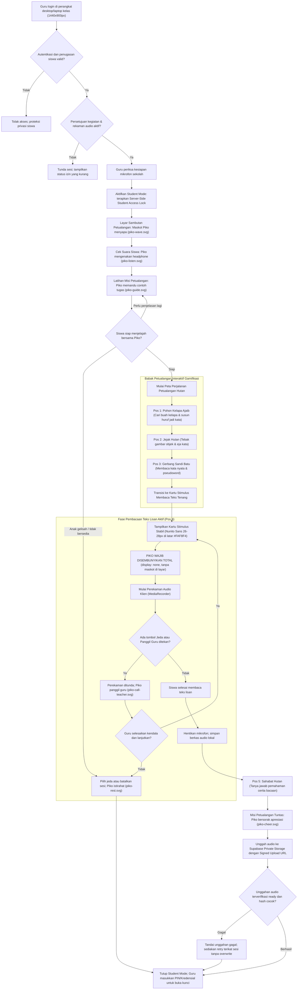
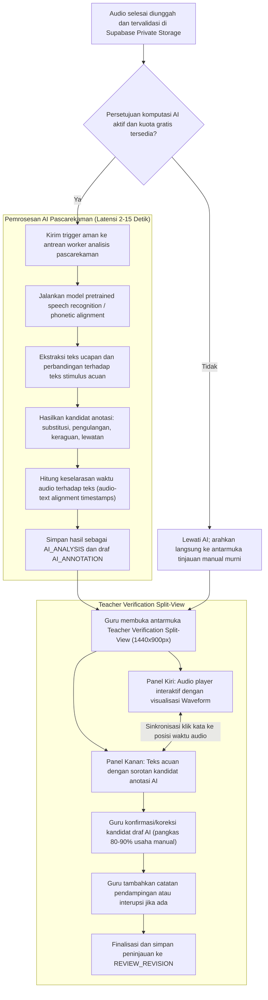
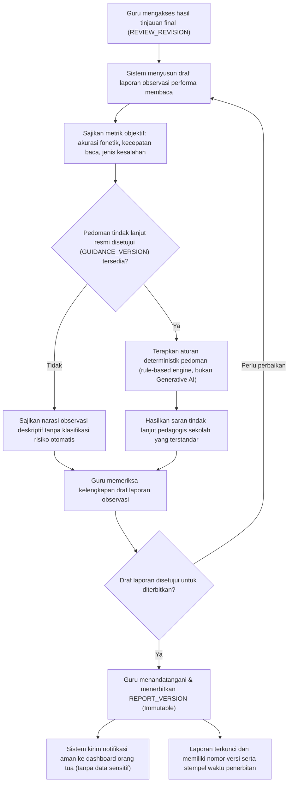
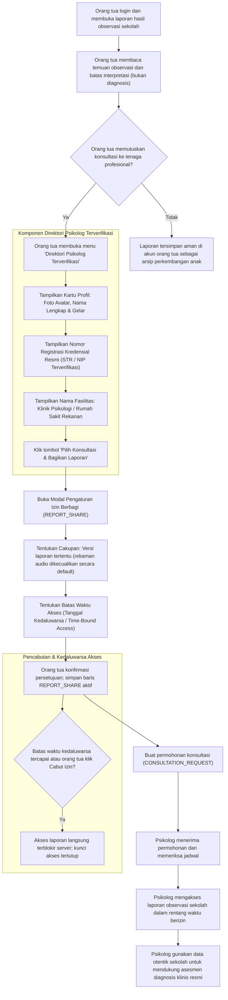
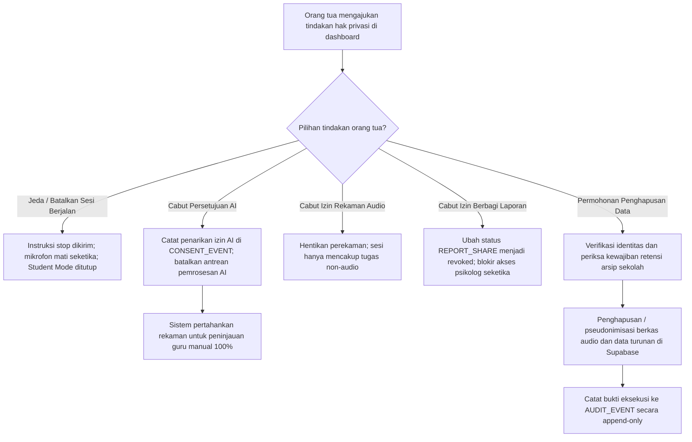

# Dyscovery: Diagram Workflow Sistem

**Versi:** 1.3, integrasi modul petualangan gamifikasi & arsitektur final  
**Tanggal:** 27 Oktober 2026  
**Tagline:** Kenali risiko, temukan dukungan.  
**Status:** Rancangan alur sistem, alur petualangan gamifikasi, dan diagram proses yang disepakati.

Acuan: [PRD](Dyscovery-PRD.md), [ERD](Dyscovery-ERD.md), [Security Rules](Dyscovery-Security-Rules.md), dan [Design System](Dyscovery-Design-System.md).

---

## Ringkasan Prinsip Arsitektur Workflow

1. **Modul Petualangan Interaktif Gamifikasi (*Dora-Style Adventure*):** Aktivitas asesmen dikemas ke dalam perjalanan eksplorasi naratif bersama Maskot Piko (mencari buah kelapa, menyusun ubin huruf, membaca sandi kata, membaca prasasti cerita lisan).
2. **Integritas Penilaian Membaca:** Pada saat anak membaca kata/teks lisan, antarmuka menyajikan kartu stimulus yang tenang dan stabil (Nunito Sans 26–28px di latar `#FAF8F4`), dan **Maskot Piko WAJIB DISEMBUNYIKAN TOTAL** untuk mencegah distraksi visual dan kecemasan membaca (*reading anxiety*).
3. **Perangkat Tunggal Guru (Single Teacher Device 1440×900px):** Seluruh sesi asesmen sekolah dijalankan pada laptop/desktop guru. Siswa tidak memiliki akun, melainkan berinteraksi melalui **Mode Siswa Sementara (*Student Mode*)** yang dikunci di sisi server (*Server-Side Student Access Lock*).
4. **Pemrosesan AI Pascarekaman (Post-Recording 2–15 Detik):** AI ucapan bekerja strictly pascarekaman setelah audio aman tersimpan di Supabase Private Storage. Tidak ada streaming real-time, live alignment, atau LLM generatif. AI bertindak sebagai *drafting assistant* yang memangkas beban kerja guru hingga 80–90%.
5. **Pemisahan Skrining Sekolah & Diagnosis Klinis:** Sekolah melakukan observasi objektif. Diagnosis resmi diserahkan kepada psikolog melalui **Direktori Psikolog Terverifikasi** dengan mekanisme izin berbagi laporan berbatas waktu (*time-bound access*).

---

## 1. Workflow Utama Lintas Pengguna

---

## 2. Alur Petualangan Gamifikasi & Skrining Membaca di Perangkat Guru

---

## 3. Pemrosesan AI Pascarekaman & Verifikasi Guru

---

## 4. Peninjauan, Penyusunan Laporan, dan Saran Tindak Lanjut

---

## 5. Direktori Psikolog Terverifikasi & Izin Berbagi Berbatas Waktu

---

## 6. Penarikan Persetujuan dan Penghentian Pemrosesan

---

## 7. Pemetaan Alur ke Entitas Database (ERD)

| Tahap Workflow | Entitas Database Terkait | Deskripsi Pemrosesan |
|---|---|---|
| **Verifikasi & Penugasan** | `PROFILE`, `SCHOOL_MEMBER`, `CHILD`, `TEACHER_ASSIGNMENT`, `GUARDIAN_LINK` | Memastikan guru dan siswa berada di sekolah yang sama dengan penugasan sah. |
| **Persetujuan Granular** | `CONSENT_EVENT` | Mencatat izin orang tua untuk kegiatan, perekaman audio, dan analisis AI secara append-only. |
| **Persiapan & Student Mode** | `ASSESSMENT_SESSION`, `STUDENT_ACCESS`, `MATERIAL_VERSION` | Mengunci akses guru di desktop (1440×900px) dan memuat paket petualangan gamifikasi. |
| **Tugas Gamifikasi Petualangan** | `TASK_ATTEMPT`, `SESSION_EVENT` | Mencatat respons babak petualangan (susun huruf, eja gambar, kata nyata/semu). |
| **Skrining Membaca Lisan** | `TASK_ATTEMPT`, `RECORDING` | Menyajikan kartu stimulus tenang, menyembunyikan Piko, merekam audio, dan unggah ke storage. |
| **Analisis AI Pascarekaman** | `AI_ANALYSIS`, `AI_ANNOTATION` | Memproses audio pascarekaman (2–15 detik) untuk menghasilkan draf anotasi tanpa streaming real-time. |
| **Peninjauan Split-View** | `REVIEW_REVISION`, `REVIEW_ANNOTATION` | Guru memvalidasi usulan draf AI melalui tampilan visual waveform, memangkas beban 80–90%. |
| **Penerbitan Laporan** | `REPORT_VERSION`, `REPORT_REVIEW`, `GUIDANCE_VERSION` | Mengunci hasil observasi sekolah menjadi laporan resmi versi immutable dengan saran berbasis aturan. |
| **Direktori & Berbagi Data** | `PSYCHOLOGIST_PROFILE`, `REPORT_SHARE`, `CONSULTATION_REQUEST` | Menampilkan profil psikolog (STR/NIP, klinik) dan memberikan izin akses laporan berbatas waktu. |
| **Jejak Audit & Keamanan** | `AUDIT_EVENT` | Merekam setiap akses data sensitif, perubahan izin, dan penerbitan laporan tanpa data rahasia. |

---

## 8. Checklist Validasi Workflow Sebelum Implementasi

- [ ] **Modul Petualangan Terintegrasi:** Alur petualangan ramah anak (menemukan kelapa/huruf, tebak gambar, membaca kata/teks) berjalan runtut dan menyenangkan.
- [ ] **Model Perangkat Tunggal:** Alur asesmen berjalan mulus pada satu laptop/desktop guru (1440×900px) tanpa membutuhkan akun atau perangkat khusus siswa.
- [ ] **Kunci Akses Siswa:** Saat mode siswa aktif, semua navigasi guru, pengaturan akun, dan akses ke data siswa lain terblokir di tingkat server.
- [ ] **Visibilitas Piko Teruji:** Piko tampil ramah saat sambutan, cek suara, latihan, jeda, dan penutupan, tetapi **tersembunyi 100% tanpa visualisasi apa pun** saat pembacaan teks aktif.
- [ ] **Pemrosesan Pascarekaman Murni:** AI hanya aktif setelah berkas audio selesai direkam dan tersimpan valid (latensi 2–15 detik); tidak ada dependensi WebSocket streaming audio real-time.
- [ ] **Teacher Verification Split-View:** Antarmuka peninjauan menyinkronkan pemutar audio dan waveform dengan teks stimulus secara interaktif, memangkas usaha peninjauan guru hingga 80–90%.
- [ ] **Direktori Psikolog Terstandar:** Menampilkan kartu profil psikolog dengan data kredensial lengkap (Avatar, Nama Lengkap, STR/NIP, Fasilitas Klinik).
- [ ] **Berbagi Berbatas Waktu (Time-Bound):** Akses psikolog ke laporan observasi dibatasi oleh tanggal kedaluwarsa dan nomor versi laporan tertentu; audio tidak dibagikan secara default.
- [ ] **Kemandirian Jalur Manual:** Bila AI dimatikan atau kuota habis, seluruh alur asesmen dan peninjauan tetap dapat diselesaikan guru secara manual.
