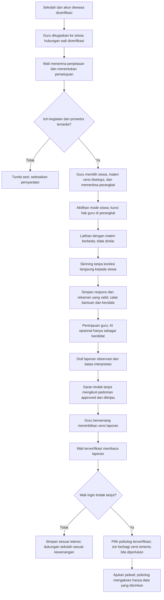
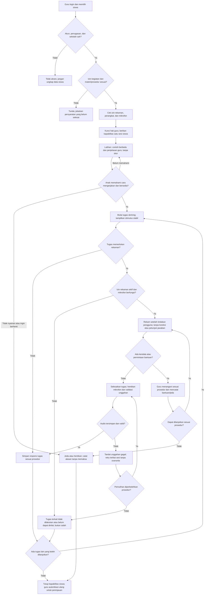
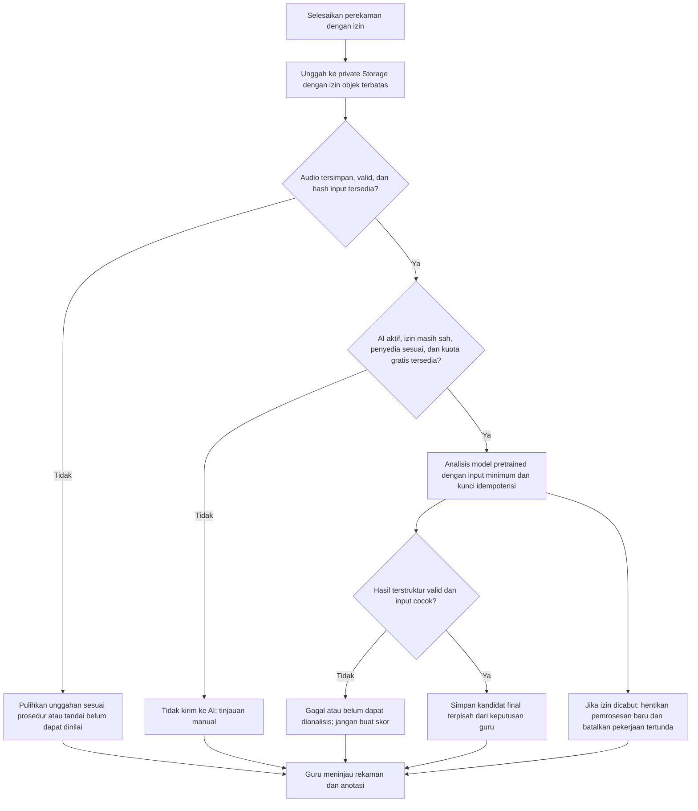
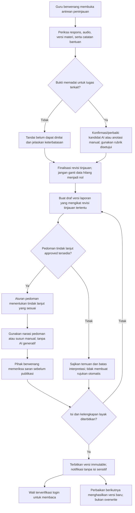
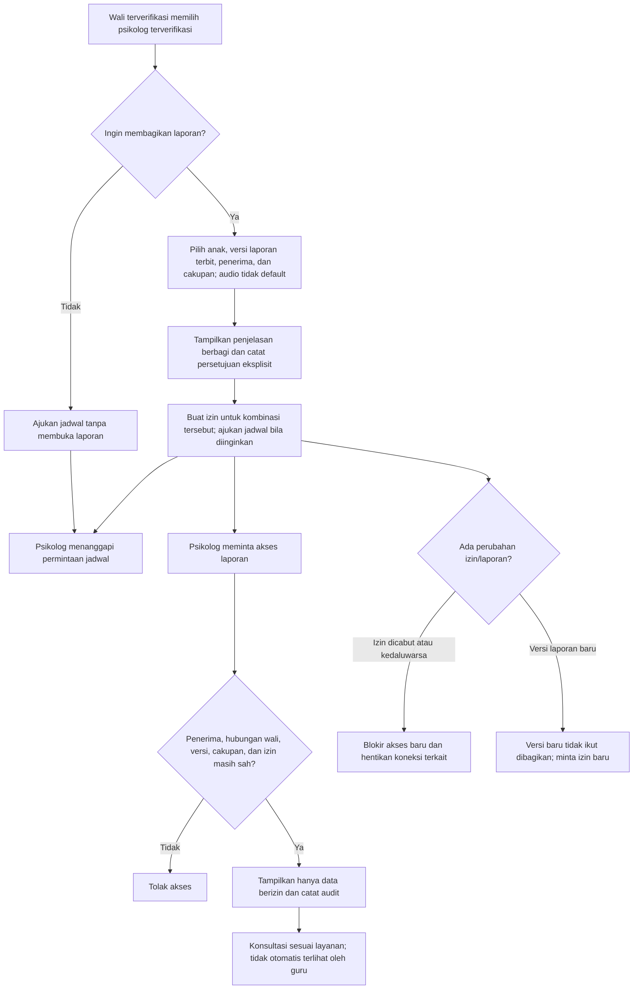
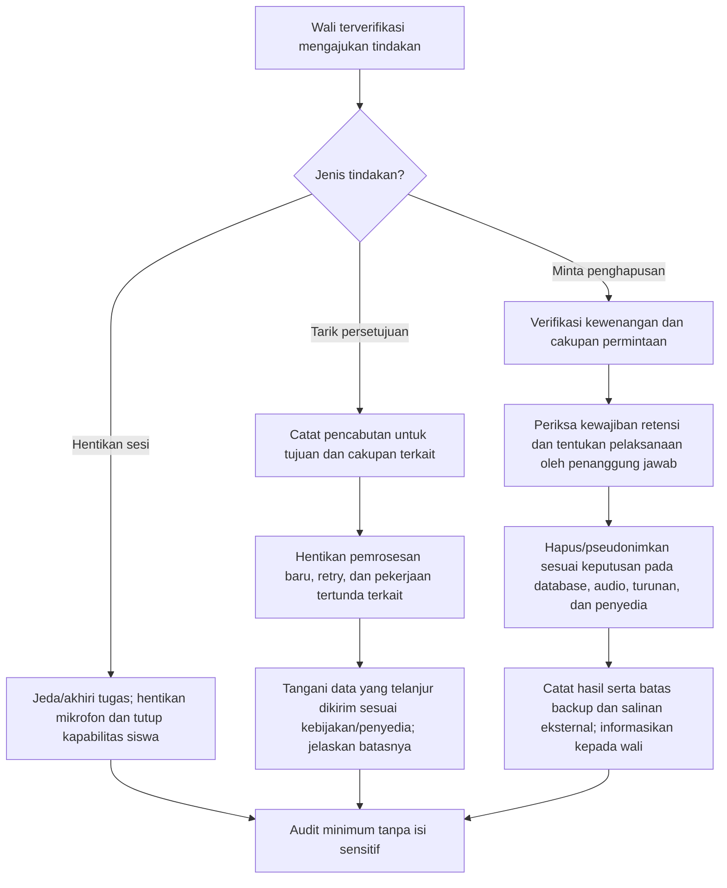

# Dyscovery: Diagram Workflow Sistem

**Versi:** 1.2, baseline dokumentasi tersinkron  
**Tanggal:** 21 Oktober 2026  
**Tagline:** Kenali risiko, temukan dukungan.  
**Status:** rancangan alur berdasarkan keputusan produk; bukan bukti aplikasi sudah dibangun atau diuji.

Acuan: [PRD](Dyscovery-PRD.md), [ERD](Dyscovery-ERD.md), [Security Rules](Dyscovery-Security-Rules.md), dan [Design System](Dyscovery-Design-System.md).

Diagram Mermaid dapat dibaca melalui penampil Markdown yang mendukung Mermaid. AI merupakan fitur opsional dengan gerbang penyedia; kegagalannya tidak menonaktifkan alur manual. Tidak ada diagnosis otomatis.

Baseline: Next.js + React + TypeScript + Tailwind CSS, backend Node.js terintegrasi, Supabase dan Vercel dengan target Rp0 sesuai ketentuan/kuota gratis. Seluruh alur responsif desktop/laptop, tablet, dan handphone; dukungan tiap tugas asesmen ditetapkan melalui pengujian perangkat. Konteks penyajian dicatat pada sesi.

Identitas platform umum, childish, dan playful; hutan pixel art hanya tema modul asesmen gamifikasi. Model pretrained opsional menganalisis audio setelah tersimpan; tidak ada training/fine-tuning, real-time, atau AI generatif saran dalam MVP. Saran memakai aturan/narasi ahli atau penulisan manual yang ditinjau.

## 1. Workflow utama lintas pengguna

Alur ini tidak menganggap seluruh siswa wajib menyelesaikan semua tugas. Kondisi tidak berizin, belum siap, berhenti, atau data tidak memadai ditangani pada diagram rinci. Sampai instrumen/aturan klasifikasi tersedia, laporan berisi kinerja dan observasi tanpa label risiko.

## 2. Persiapan, latihan, dan skrining

Retry unggahan tidak berarti anak otomatis diminta membaca ulang. Pengulangan tugas hanya mengikuti prosedur instrumen. Penghentian menghasilkan laporan/status parsial bila sesuai, bukan laporan yang menyamar sebagai sesi lengkap.

## 3. Analisis suara pascarekaman dengan model pretrained

Cabang pencabutan adalah interupsi, bukan langkah yang harus selalu terjadi. Periksa izin lagi sebelum dispatch/retry; respons yang telanjur diproses ditangani sesuai kebijakan. Kandidat final AI bukan penilaian final guru. Analisis lama atau terlambat tidak boleh mengubah revisi tinjauan yang telah final. Pseudoword pada tahap awal tetap manual. Real-time dan training/fine-tuning di luar MVP.

## 4. Peninjauan, laporan, dan saran tindak lanjut

Laporan parsial harus jelas status dan batasnya. Tidak ada persentase atau kategori risiko tanpa instrumen serta aturan yang mendukung. AI tidak memilih ambang maupun menentukan diagnosis.

## 5. Pembagian laporan dan permintaan konsultasi

Pencabutan tidak menghapus salinan yang sudah diunduh dan belum tentu mematikan signed URL yang telah diterbitkan sebelum kedaluwarsa. Sampaikan batas ini; gunakan akses berotorisasi tiap permintaan bila pencabutan seketika diperlukan. Penjadwalan bukan izin mengakses seluruh data.

## 6. Penarikan persetujuan dan penghapusan

Detail masa simpan, pengecualian retensi, tenggat, dan proses backup harus ditetapkan sebelum data anak dipakai. Diagram ini tidak menjanjikan penghapusan instan dari seluruh pihak.

## 7. Pemetaan alur ke ERD

| Tahap | Entitas utama |
|---|---|
| Verifikasi dan penugasan | PROFILE, SCHOOL_MEMBER, CHILD, TEACHER_ASSIGNMENT, GUARDIAN_LINK, PSYCHOLOGIST_PROFILE |
| Persetujuan | CONSENT_EVENT dan GUARDIAN_LINK |
| Persiapan/latihan/skrining | MATERIAL_VERSION, ASSESSMENT_SESSION, STUDENT_ACCESS, TASK_ATTEMPT, SESSION_EVENT |
| Rekaman dan AI | RECORDING, AI_ANALYSIS, AI_ANNOTATION |
| Peninjauan | REVIEW_REVISION, REVIEW_ANNOTATION |
| Laporan dan saran | REPORT_VERSION, REPORT_REVIEW, GUIDANCE_VERSION |
| Berbagi dan penjadwalan | REPORT_SHARE, CONSULTATION_REQUEST |
| Jejak tindakan | AUDIT_EVENT |

## 8. Pemeriksaan sebelum implementasi

- [ ] Jalur manual berfungsi tanpa AI dan tanpa real-time.
- [ ] Latihan tidak memengaruhi skor; skrining tidak mengirim koreksi ke siswa.
- [ ] Perangkat guru dan kapabilitas siswa tidak berbagi hak akses.
- [ ] Izin diperiksa kembali sebelum pengiriman/retry; kuota gratis diperiksa sebelum proses AI.
- [ ] Rekaman rusak/gagal dan tugas dilewati tidak menjadi nilai nol.
- [ ] Revisi tinjauan dan versi laporan tidak tertimpa hasil terlambat.
- [ ] Pembagian mengikat penerima dan versi tertentu; konsultasi tetap terpisah.
- [ ] Penyedia AI, instrumen, aturan beberapa wali, retensi, dan penanggung jawab sudah diselesaikan sebelum penggunaan nyata.
- [ ] Tidak ada real-time, training/fine-tuning, atau saran AI generatif dalam scope MVP.
- [ ] Seluruh alur diuji desktop, tablet, dan handphone; konteks penyajian asesmen dicatat.
- [ ] Tema hutan hanya modul gamifikasi; React dan Tailwind menjadi dasar antarmuka responsif.
- [ ] Tidak ada billing/upgrade tanpa persetujuan; kuota habis tidak menghapus data valid.

Tidak ada hasil uji pengguna, akurasi AI, atau validitas skrining yang diklaim oleh diagram ini.
