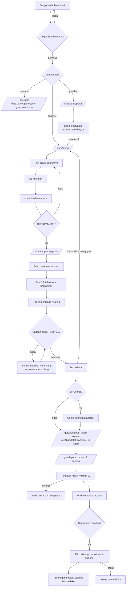
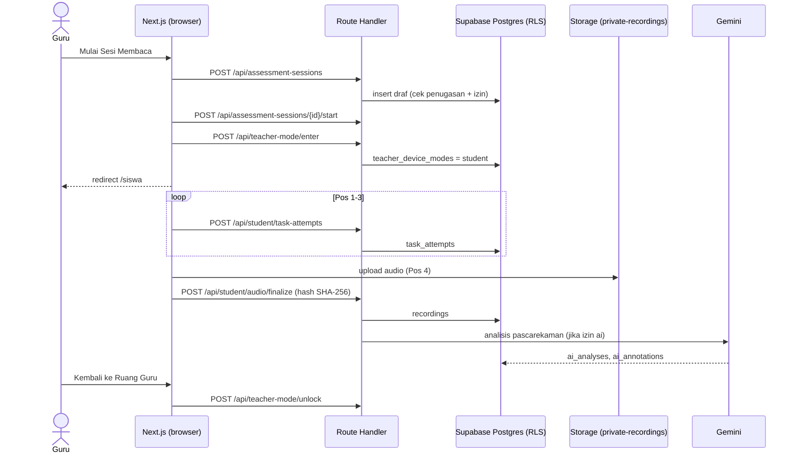
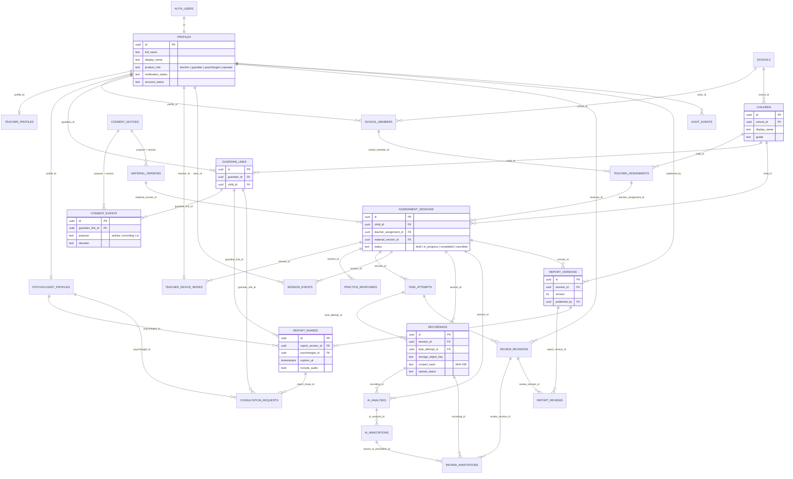
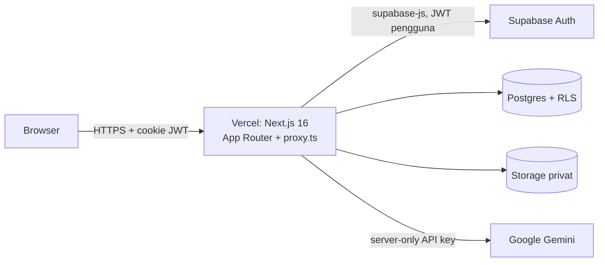

# Dyscovery

Platform web untuk **skrining awal risiko disleksia** pada siswa kelas 2 SD. Guru mendampingi siswa menjalani aktivitas membaca berbentuk petualangan bersama maskot Piko, sistem merekam respons dan bacaan nyaring, AI (Gemini) menyiapkan kandidat anotasi, lalu **guru** meninjau dan menerbitkan laporan observasi untuk orang tua. Orang tua dapat membagikan laporan kepada psikolog terverifikasi dengan izin berbatas waktu.

> Dyscovery **bukan alat diagnosis**. Hasilnya berupa profil performa dan temuan kegiatan, tanpa kategori risiko buatan. Diagnosis disleksia tetap memerlukan pemeriksaan profesional.

- Produksi: https://dyscovery.vercel.app
- Status implementasi: [Docs/Implementation-Progress.md](Docs/Implementation-Progress.md)

## Daftar isi

1. [Peran pengguna](#peran-pengguna)
2. [Fitur utama](#fitur-utama)
3. [Workflow](#workflow)
4. [ERD](#erd)
5. [Autentikasi & otorisasi (JWT)](#autentikasi--otorisasi-jwt)
6. [Arsitektur & teknologi](#arsitektur--teknologi)
7. [Struktur halaman & API](#struktur-halaman--api)
8. [Akun uji](#akun-uji)
9. [Pengembangan lokal](#pengembangan-lokal)
10. [Batasan yang diketahui](#batasan-yang-diketahui)
11. [Rujukan](#rujukan)

## Peran pengguna

| Peran (`product_role`) | Ruang kerja | Tugas |
|---|---|---|
| `operator` | `/operator` | Mengelola data siswa, penugasan guru, dan memantau status izin wali. |
| `teacher` | `/guru/*`, `/siswa` | Memilih siswa, menjalankan sesi, meninjau rekaman & kandidat AI, menerbitkan laporan. |
| Siswa (tanpa akun) | `/siswa` di perangkat guru | Mengikuti 4 pos kegiatan. Tidak mengetik kredensial, tidak memilih profil. |
| `guardian` | `/orangtua/*` | Memberi persetujuan, membaca laporan anak, membagikan laporan ke psikolog. |
| `psychologist` | `/orangtua/*` (tampilan berbagi) | Membaca laporan yang dibagikan selama izin masih berlaku. |

Setiap peran **hanya** dapat membuka ruang kerjanya sendiri; lihat [Autentikasi & otorisasi](#autentikasi--otorisasi-jwt).

## Fitur utama

- **Login umum `/masuk`** dengan pengalihan otomatis sesuai peran akun.
- **Dasbor guru**: kartu "siswa berikutnya", uji mikrofon nyata (Web Audio API), statistik sesi, daftar siswa, dan antrean "Perlu ditinjau".
- **Sesi kegiatan siswa 4 pos**: susun ubin huruf, tebak kata bergambar (benda & hewan), dan membaca nyaring dengan mikrofon. Tanpa skor atau tanda benar–salah di layar anak; tersedia tombol Jeda dan Bantuan Guru.
- **Rekaman privat**: audio diunggah ke bucket privat `private-recordings` beserta hash SHA-256; pemutaran memakai signed URL 60 detik.
- **Kandidat anotasi AI pascarekaman** (Gemini), hanya bila izin `ai` aktif. Kandidat AI tidak pernah menimpa keputusan guru.
- **Tinjauan guru**: pemutar 1.0x/0.75x, waveform tersinkron teks, verifikasi/tolak kandidat AI, rubrik ketepatan, kelancaran, dan kualitas audio.
- **Laporan berversi**: setiap penerbitan adalah snapshot tetap; koreksi menghasilkan versi baru.
- **Persetujuan wali per tujuan**: `activity`, `recording`, `ai`, diperiksa ulang di setiap operasi (bukan hanya saat draf dibuat).
- **Berbagi ke psikolog**: berbatas waktu (7/14/30 hari), audio tidak ikut secara default, dapat dicabut kapan saja.
- **Audit log** untuk aksi sensitif.

## Workflow

### Alur end-to-end



### Sesi kegiatan (urutan antar komponen)



## ERD

Diturunkan langsung dari `supabase/migrations/` (28 migrasi). Semua tabel berada di skema `public` dengan Row Level Security aktif.



Atribut yang ditampilkan hanya kolom kunci; definisi lengkap ada di file migrasi.

## Autentikasi & otorisasi (JWT)

**Ya, sistem sudah menerapkan autentikasi berbasis JWT** melalui Supabase Auth. Berikut lapisannya:

| Lapisan | Implementasi | Lokasi |
|---|---|---|
| **Identitas (JWT)** | Supabase Auth (GoTrue) menerbitkan *access token* JWT dan *refresh token* saat login email/password atau Google OAuth. | `src/app/api/auth/[action]/route.ts` |
| **Penyimpanan token** | Token disimpan di cookie oleh `@supabase/ssr` (bukan `localStorage`). | `src/lib/supabase/server.ts`, `client.ts` |
| **Verifikasi & penyegaran** | Setiap request melewati `proxy.ts` yang memanggil `supabase.auth.getClaims()` untuk memverifikasi tanda tangan JWT dan menyegarkan sesi. | `src/proxy.ts` |
| **Otorisasi halaman per peran** | `proxy.ts` membaca `product_role`; belum login → `/masuk`, salah peran → dikembalikan ke ruang kerjanya sendiri. | `src/proxy.ts`, `src/lib/auth/role-home.ts` |
| **Otorisasi API** | Setiap route handler memanggil `auth.getUser()` dan memeriksa peran, status verifikasi, dan status akun (401/403). | `src/app/api/**` |
| **Otorisasi data (RLS)** | Postgres Row Level Security memakai `auth.uid()` dari JWT: 26 tabel ber-RLS, 40 policy, ditambah fungsi `security definer` untuk operasi sensitif (izin efektif, penerbitan, berbagi). | `supabase/migrations/` |
| **Proteksi tambahan** | Cek header `Origin` pada endpoint auth, batas ukuran body, pesan error yang tidak membocorkan keberadaan akun, signed URL audio 60 detik, `Cache-Control: private, no-store`. | route handler terkait |

Pemetaan peran → ruang kerja:

```text
teacher                 → /guru/*, /siswa
guardian, psychologist  → /orangtua/*
operator                → /operator, /admin
```

Diuji oleh `src/lib/auth/role-home.test.ts` dan `scripts/check-login-roles.mjs`.

## Arsitektur & teknologi



| Bagian | Teknologi |
|---|---|
| Frontend & API | Next.js 16 (App Router, Route Handlers), React 19, TypeScript 5.9 |
| Gaya | CSS global + Tailwind CSS 4; font Nunito Sans (UI) dan Andika (teks bacaan anak) |
| Auth, DB, Storage | Supabase (`@supabase/ssr`, `@supabase/supabase-js`) |
| AI | Google Gemini (server-side, dijaga flag `ENABLE_AI_PROCESSING`) |
| Hosting | Vercel |

## Struktur halaman & API

**Halaman**

| URL | Peran | Isi |
|---|---|---|
| `/` | publik | Landing page |
| `/masuk` | publik | Login, daftar, lupa/atur ulang kata sandi |
| `/guru/siswa` | guru | Dasbor guru & mulai sesi |
| `/guru/rekaman` | guru | Tinjau rekaman & kandidat AI |
| `/guru/laporan` | guru | Susun & terbitkan laporan |
| `/guru/simulasi` | guru | Simulasi alur kegiatan |
| `/siswa` | guru (perangkat) | Sesi kegiatan siswa 4 pos |
| `/orangtua/laporan` | wali, psikolog | Laporan anak & berbagi ke psikolog |
| `/operator`, `/admin` | operator | Manajemen data sekolah |

**API (Route Handlers, `src/app/api`)**

| Kelompok | Endpoint |
|---|---|
| Auth | `POST /api/auth/{login,register,google,logout,onboarding,forgot,reset}`, `GET /api/auth/profile` |
| Data sekolah | `/api/children`, `/api/children/[id]`, `/api/assignments`, `/api/materials` |
| Sesi | `/api/assessment-sessions`, `.../[id]/start`, `.../complete`, `.../events`, `.../practice` |
| Mode perangkat | `/api/teacher-mode/{status,enter,unlock}` |
| Siswa | `/api/student/session`, `/api/student/task-attempts`, `/api/student/practice`, `/api/student/audio/{upload,finalize}` |
| Tinjauan & laporan | `.../[id]/recordings/[recordingId]`, `.../[id]/reviews`, `.../reviews/finalize`, `.../[id]/reports` |
| AI | `.../[id]/ai`, `.../[id]/ai/dispatch` |
| Wali & psikolog | `/api/guardian/consents`, `/api/psychologists`, `/api/reports/[id]/shares`, `.../shares/[shareId]`, `/api/consultations` |

## Akun uji

Akun berikut hanya untuk pengujian dan tidak terhubung ke data anak nyata.

| Peran | Email | Kata sandi | Diarahkan ke |
|---|---|---|---|
| Guru | `guru@dyscovery.id` | `GuruDyscovery2026!` | `/guru/siswa` |
| Orang tua / wali | `wali@dyscovery.id` | `WaliDyscovery2026!` | `/orangtua/laporan` |
| Operator sekolah | `operator@dyscovery.id` | `OperatorDyscovery2026!` | `/operator` |

## Pengembangan lokal

Butuh Node.js 22 (≥ 22.17) dan npm. Versi dependensi dikunci di `package-lock.json`.

```sh
cp .env.example .env.local   # isi URL & publishable key Supabase, GEMINI_API_KEY
npm ci
npm run dev                  # http://localhost:3000
```

| Perintah | Fungsi |
|---|---|
| `npm run lint` | ESLint |
| `npm run typecheck` | Pemeriksaan tipe TypeScript |
| `npm run build` / `npm start` | Build & jalankan produksi |
| `npm run db:migrate` | Terapkan migrasi `supabase/migrations/` |
| `npm run test:db` | Tes database |
| `node --test tests/` | Tes endpoint & validasi input |
| `node --env-file=.env.local scripts/check-login-roles.mjs` | Verifikasi login & pengalihan tiap peran |

Jangan memasukkan data anak nyata dan jangan menyimpan kredensial di Git; file `.env*` diabaikan kecuali `.env.example`.

## Batasan yang diketahui

- Halaman operator dan sebagian portal orang tua (direktori psikolog) masih memakai data yang ditulis di kode; belum sepenuhnya dibaca dari database.
- Ambang deteksi suara mikrofon masih nilai tetap (`SILENCE_RMS = 0.02`), belum dikalibrasi per perangkat.
- Validitas instrumen untuk anak berbahasa Indonesia dan ketepatan anotasi AI belum diuji; hasil tidak boleh dipakai sebagai kategori risiko.

## Rujukan

- International Dyslexia Association. (2019). *Universal screening: K–2 reading* [Fact sheet]. https://dyslexiaida.org/universal-screening-k-2-reading/
- Jap, B. A. J., Borleffs, E., & Maassen, B. A. M. (2017). Towards identifying dyslexia in Standard Indonesian: The development of a reading assessment battery. *Reading and Writing, 30*(8), 1729–1751. https://doi.org/10.1007/s11145-017-9748-y
- Rello, L., Baeza-Yates, R., Ali, A., Bigham, J. P., & Serra, M. (2020). Predicting risk of dyslexia with an online gamified test. *PLOS ONE, 15*(12), e0241687. https://doi.org/10.1371/journal.pone.0241687
- Sanfilippo, J., Ness, M., Petscher, Y., Rappaport, L., Zuckerman, B., & Gaab, N. (2020). Reintroducing dyslexia: Early identification and implications for pediatric practice. *Pediatrics, 146*(1), e20193046. https://doi.org/10.1542/peds.2019-3046
- van der Velde, M., Harmsen, W., Veldkamp, B. P., Feskens, R., Keuning, J., & Swart, N. (2025). Speech enabled reading fluency assessment: A validation study. *International Journal of Artificial Intelligence in Education, 35*(4), 2569–2595. https://doi.org/10.1007/s40593-025-00480-y
